# Crucivar ability set v2: morning report

**Status:** designed, built and tested. **Not human-approved:** nothing here is approved until Chzy18 plays it.

All five abilities are built and merged into the integration branch, and v2 is the default for the "Crucivar (area 2)" practice entry.

**Push and PR are blocked.** GitHub has answered 403 "Your account is suspended" since about 10:25. So:
- the integration branch and both late ability branches exist **only locally**;
- the draft PR into `feature/boss-crucivar` isn't open yet.

See "Blocked" at the end.

## How to launch it

**Editor (always works):**
1. Open the project `C:\Users\BS_Ch\Documents\Codex\last bell\crucivar-abilities\unity` in Unity 6000.6.6f1.
2. Use the menu **Last Bell → Bosses → Crucivar in the Brass Foundry**, then press **Play**.
3. On the run menu choose **Practice → Crucivar (area 2)**. Pick the level on the menu's difficulty row: Easy / Medium / Hard. Hard adds Second Press.

**Command line (editor):**

    "C:\Program Files\Unity\Hub\Editor\6000.6.6f1\Editor\Unity.exe" -projectPath unity -executeMethod LastBell.Run.EditorTools.CrucivarTestTools.OpenScene

Add these flags as needed:
- `-lastbellAbilitySet v1` plays the original five attacks for comparison.
- `-lastbellAbility crucivar.mould_press` (or `crucivar.gear_chain`, `crucivar.bellows_draw`, `crucivar.great_casting`, `crucivar.second_press`) fires that one ability on loop.
- `-lastbellDifficulty easy|medium|hard` sets the level.

**Windows player:** PLAYER_BUILD_STATUS

    unity\Builds\Windows\LastBell.exe -screen-fullscreen 0 -screen-width 1600 -screen-height 900 [-lastbellAbilitySet v1] [-lastbellAbility <id>]

Then choose Practice → Crucivar (area 2). The map loads the Brass Foundry.

## Test results (integration branch `feature/crucivar-abilities-v2`, local HEAD 788c6cd)

| Suite | Command flag | Result |
|---|---|---|
| Crucivar v2 (5 ability tests + phase plan) | `-crucivarV2Test` | **210 passed, 0 failed** |
| Crucivar v1 (original attacks, `-lastbellAbilitySet v1` forced) | `-crucivarTest` | **28 passed, 0 failed** |
| Full run loop | `-lastbellAutotest` | RUNLOOP_RESULT |

**Known editor-only errors** (BUILD-PLAN.md, not gameplay): the run-loop suite fails only its "no errors or exceptions logged" check, because of two errors:
- `UnityEditor.Search` indexing on startup (`SearchDatabase.EnumerateAll` ArgumentOutOfRange);
- `SkywardSpireArena.OnValidate` touching `Renderer.material` on a prefab.

Both come from the copied Library or the editor. The same single failure appears on the baseline before any v2 work (172/173 at 09:30).

**Each step, Crucivar suites** (v2 / v1):

| After | v2 | v1 |
|---|---|---|
| baseline (scaffold + phase plan, stub abilities) | 13/13 | 28/28 |
| + Bellows Draw | 38/38 | 28/28 |
| + Gear Chain | 88/88 | 28/28 |
| + The Great Casting | 123/123 | 28/28 |
| + Mould Press + Second Press | **210/210** | **28/28** |

**Per-ability tests in their own worktrees** (before merge):

| Ability | Result |
|---|---|
| Bellows Draw | 28/28 |
| Gear Chain | 53/53 |
| The Great Casting | 38/38 |
| Mould Press | 53/53 |
| Second Press | 40/40 |

Reports and screenshots are in `crucivar-abilities\test-out\<step>\v2\` (not committed: `crucivar-v2-report.txt` plus PNGs of each telegraph).

## Escape check

`tools/encounter-escape/crucivar-escape-check.ps1`, unchanged since the design (results in `escape-*.md`):

| Level | Result |
|---|---|
| Easy | every worst case PASS (14 rows) |
| Medium | every worst case PASS (14 rows) |
| Hard | every worst case PASS (15 rows; includes Second Press) |

The tightest margin is 0.58 s: Mould Press, a bad split from the far edge to the far bay, at 4.2 m/s with one dash. In Unity the scripted players repeat the key routes at 4.2 m/s with finite stamina:
- every Mould Press bad split made it with a dash;
- Gear Chain partners from opposite edges were in band at 1.93 s of 3.0 s;
- the Bellows walk-out after the pull worked by walking only;
- joining the pour from 12.1 m on the far side worked;
- leaving the Second Press mould took 0.60 s of 2.0 s.

## Status of each ability

| Ability | Status | Notes |
|---|---|---|
| Mould Press | **complete (stand-in look)** | Towers per player count follow the table for N = 1–8, and pairs alternate. Solo is I then II on adjacent bays, 2.6 s apart. Shares are 20 each; an empty mould downs everyone. It feeds `MouldResult` to Second Press. The chime is procedural (no audio assets yet), and the molten fill hides most of the coral hatch, so tune that in a look pass. |
| Gear Chain | **complete (stand-in look)** | Nearest is paired with farthest; an odd player or a solo player is chained to a rim post. The band is 6–10 m (Easy 5–11 m); a snap deals 28 with no knockback. A dash breaks the chain for both ends. A downed partner's chain ends, and the survivor is re-chained to a post. Stand-in chain, guide rings and post. |
| Bellows Draw | **complete (stand-in look)** | Slag rim at 2.0 s (30); burning edge 10/s until 7.0 s. Inhale pull of 1.5 m with no damage at 2.2–2.6 s. Point-blank blast at 3.5 s (30, 1.5 m knockback). Every vent opens (`CrucivarRig.VentsAll`). `SlagRim()` runs alone for the phase-plan pairings. No bellows sound yet. |
| The Great Casting | **complete (presentation partial)** | The pour aims at the farthest player, locks at 1.5 s and resolves at 3.5 s. The line split is 80 shared; solo it's a 40 lane. The march has 0/3/6 spokes 30° off the pour, stamping rim-first at 5.0–7.0 s (18 each). **Not built:** the phase-3 floor-channel glow decals, the molten core line and the gear-tooth rims (presentation only; the hazards are complete). |
| Second Press (Hard) | **complete (stand-in look)** | It telegraphs the moment the towers resolve and lands 2.0 s later (6.2 s on the phase clock). r 2.2 Strike, 25 damage, 1.5 m push **toward the centre**. It picks the fullest mould (ties: lowest numeral, then NE, SE, SW, NW; solo: tower II). Absent on Easy and Medium. The ratchet sound is a stub. |
| Phase plan + second form | **complete** | It follows ABILITIES.md exactly; the test checks the order per phase. The second form "Casting Heat" comes at 65 % (insulation falls), then "Open Pressure" at 30 %. Each change takes 1.5 s, deals no damage, has no heal and keeps the same HP bar; two thresholds in one burst queue one change. At most two damaging patterns are live at once (checked across the whole plan). |

## Shared-system changes (separate commits, reviewed)

- `144c80c` (Abilities session):
  - shared soak and line split: `Hazard.ShareTotal / ShareCount / WipeIfEmpty`;
  - `HazardShape.Tether` with `Hazard.Includes`;
  - `PlayerController.Pull`: no damage, stun or interrupt, never a teleport;
  - `ReceiveHit(h, damage)`, `ForceDown` (the empty-soak wipe) and `DebugRevive` (tests only).
- `bc1dfbc` (Abilities session): `HazardSystem.Spawned` event (tests).
- `c5a82be` (Bellows Draw): `CrucivarRig.VentsAll`.
- `96cf92f` (Second Press): `Hazard.Push`, an optional knockback-direction override.

None of these changes existing attacks. The v1 suite and the run-loop suite still pass, apart from the known editor noise.

Tooling: `tools/crucivar/compile-check.sh` is a 16 s Roslyn compile check of all scripts. It needs neither Unity nor the build lock.

## Conflicts with settled rules (kept the rule)

All of ABILITIES.md's conflicts still apply: empty soak wipes, dash breaks tethers, nothing under 2.0 s, knockback near walls, scenery stays harmless. Added tonight:
- **Share formula.** Brief 01's "total ÷ max(numeral, inside)" contradicts its own example: "a '2' mould taken alone deals 40". The build uses ceil(total ÷ players inside). That gives 40 alone and 20 each for two, and never more than one share each when over-soaked.
- **Slag edge on Hard.** The burn isn't scaled by Hard's ×1.3, which is existing `ReceiveBurn` behaviour shared by all standing pools.

## Open questions for Chzy18

Carried over from ABILITIES.md (still open):
- D1 dash vs Gear Chain;
- D2 over-soak;
- D3 the form change at 65 % or 50 %;
- D4 boss HP vs player count;
- D5 pull strength;
- D6 showing chain partners early;
- D7 four vs three moulds at 5–8 players.

New from the build:
1. **Gear Chain dash.** The dash breaks the chain for *both* ends, and only a dash started after the clamp counts. With that rule a 30-stamina dash always escapes Gear Chain (D1). Also, a broken chain still holds the boss's script for the full 3.0 s.
2. **Great Casting spokes.** They start at the boss's real position (it can stand up to 3 m off the anvil). Each stamp sits where its spoke crosses the arena rings at 12.5 / 10.5 / 8.5 / 6.5 / 4.5 m from the centre, so the cooled pour channel stays a true gap.
3. **Great Casting pour knockback.** The split pour has none; the solo lane has normal knockback.
4. **Mould Press solo bays.** Tower I is the current pair's first bay, and tower II is the next pair's first bay.
5. **Compass.** The run layout puts the entry at +z = south, so north is −z. The bays NE / SE / SW / NW and the Second Press tie order follow that.
6. **Bellows Draw.**
   - The blast radius is measured from the boss centre.
   - The rim has no knockback, because outward would pin players to the wall.
   - The ability played on its own (`-lastbellAbility crucivar.bellows_draw`) always uses the 3.5 s punish. Phase 3's 2.0 s applies only in the full fight.
7. **Second Press on Easy.** In practice it can be forced on Easy; it then uses the ×1.25 warning (2.5 s).
8. **Audio.** The chime (Mould Press), bellows (Bellows Draw) and ratchet (Second Press) are procedural or stubbed. The project has no audio pipeline yet.
9. **Look pass needed.** Every telegraph uses the shared coral/amber renderer plus stand-in geometry: numerals, chains, chevrons, stamps. None of it is final art.

## Process notes

- Session starts were refused on the overnight turn, so the five abilities were left as proposal cards. The first subagent attempt hit the usage limit and wrote nothing. Chzy18 then started the five cards as sessions, and they built the abilities in worktrees `crucivar-ability-<id>`.
- The machine-wide Unity lock was the bottleneck: four boss lanes waited up to 2.5 h for test slots. C: filled up around 09:00, and a 09:00 Second Press run hung until space was freed (about 40 GB at 09:36).
- One ability bug was sent back and fixed: Second Press originally waited 2.0 s before its 2.0 s warning, landing at 8.2 s instead of 6.2 s.

## Completed / Next / Blocked

**Completed:** COMPLETED_LINE

**Next:**
- Push `feature/crucivar-abilities-v2` and the ability branches `feature/crucivar-ability-mould_press` and `feature/crucivar-ability-second_press` (both local only).
- Open the draft PR into `feature/boss-crucivar`.
- Chzy18 plays it: Practice → Crucivar (area 2) on each level.
- Then a look pass (the Great Casting floor channels, the mould fill) and audio hooks.

**Blocked:**
- **The GitHub account is suspended** (`remote: Your account is suspended`, HTTP 403 on every push since about 10:25). Nothing can be pushed and no PR can be opened until it's restored.
- Not yet on GitHub:
  - the integration branch, which GitHub has only up to 7affa56 (the Bellows Draw merge); everything after it is local;
  - `feature/crucivar-ability-mould_press` bb1a9ec;
  - `feature/crucivar-ability-second_press` 95e9fb1.

  The other ability branches are fully pushed.

## Screenshots (from the 210/210 v2 run, 960 px)

| Ability | Screenshot |
|---|---|
| Mould Press: four players, bad split | 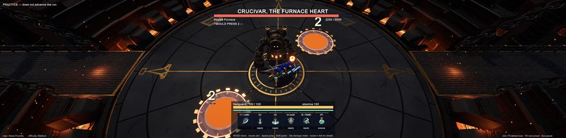 |
| Mould Press: eight players, four moulds | 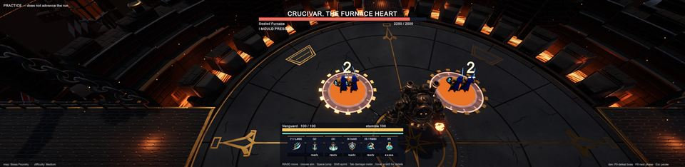 |
| Gear Chain: out of band (coral) | 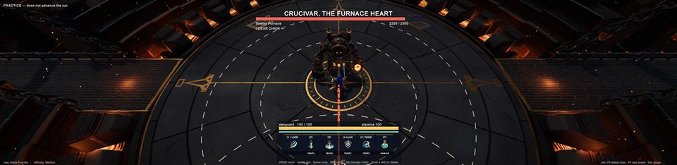 |
| Gear Chain: in band | 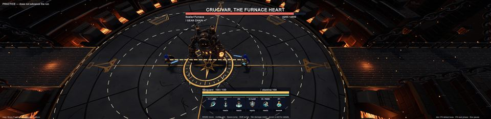 |
| Gear Chain: solo rim post | 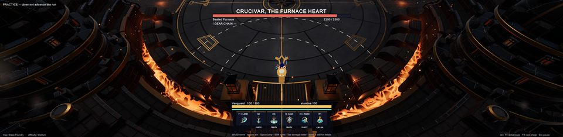 |
| Gear Chain: eight players | 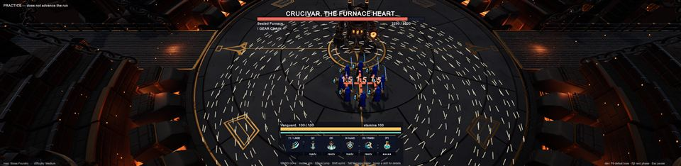 |
| Bellows Draw: windup (slag rim + blast) | 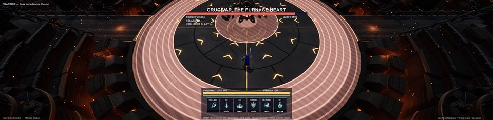 |
| Bellows Draw: inhale | 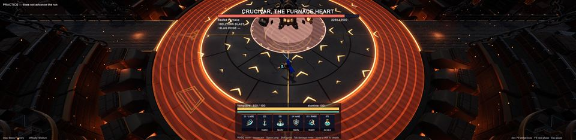 |
| The Great Casting: pour + march | 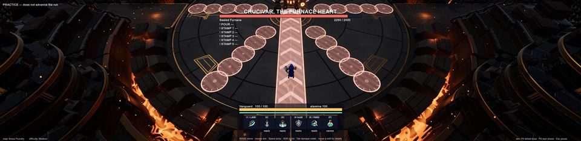 |
| Second Press (Hard) | 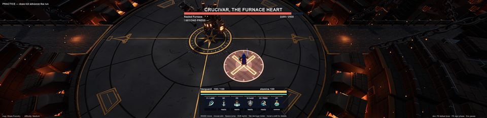 |
| Second form at 65 % (Casting Heat) | 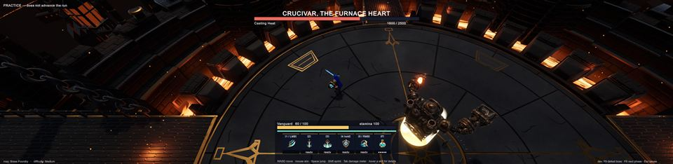 |
