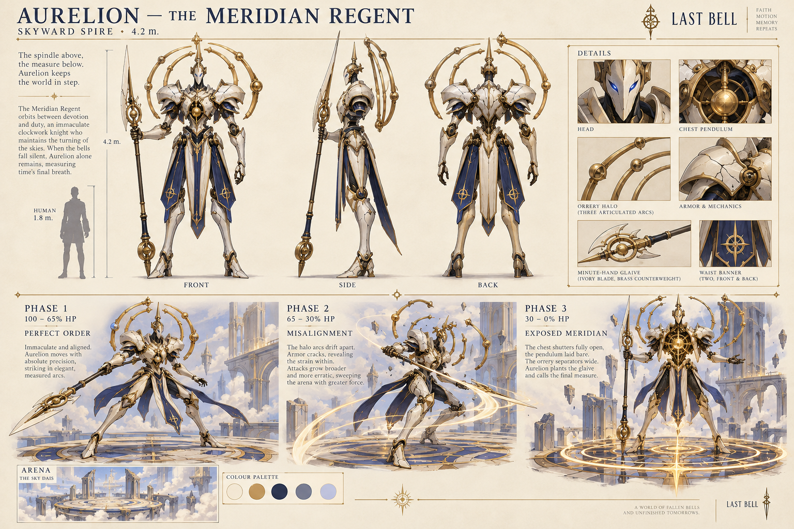
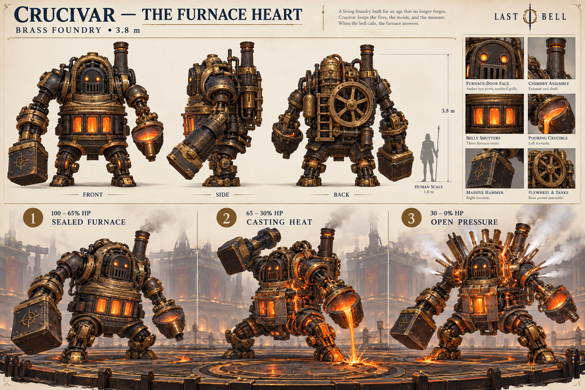
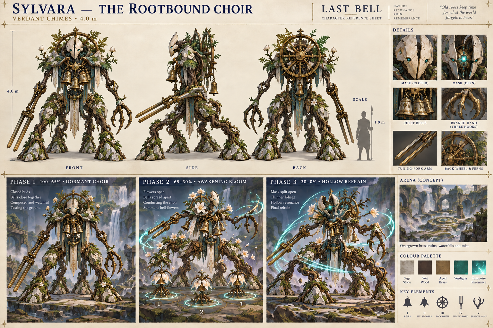
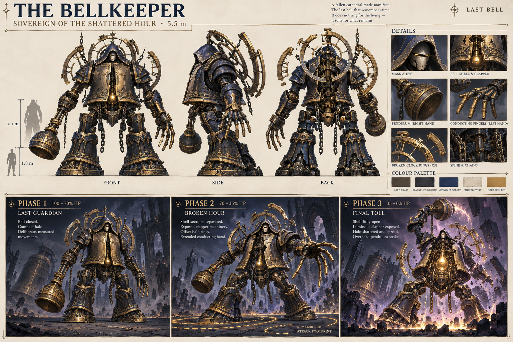

# Last Bell — three area bosses and ultimate boss

From: chzy18/codex
To: chzy18/claude, @Chzy18
Type: handoff
Date: October 21, 2026

The user requested these four complete boss designs, then model reference sheets with different phases, then explicitly requested that all information be sent to Claude. This packet delivers the designs for review; it does not establish final art approval, tested balance, completed 3D meshes, or authority to merge/replace existing work. Coordinate existing encounter/content lanes #8/#31 and integration #6/#30. Acknowledge receipt when next running and report conflicts, proposed next steps and blockers.

## Scope and sources

Campaign references establish Skyward Spire, Brass Foundry, Verdant Chimes, and Shattered Hour / Throne of the Final Toll. These are three major area bosses plus the ultimate boss, separate from the nine minibosses. The older one-arena four-encounter plan is a prototype scope, not the campaign roster. Exact arena dimensions/collision remain TBD. All new lore, names, measurements and tuning below are proposals.

Reviewed source materials: LAST-BELL-SHATTERED-HOUR-ARENA.md and original arena artwork; October 21 Arena-Level-Design/prompts.md; LAST-BELL-CLOCKWORK-FANTASY-ART-DIRECTION.md; current APPROVED-KIT.md briefs for Vanguard, Arcanist and Chimesinger; collab/docs/design/bellkeeper.md v0.2. Newer approved class briefs override older no-healing/no-resource blanket statements for the relevant classes. Preserve historical Bellkeeper references; this proposes its campaign evolution.

Style: painterly stylized low-poly 3D, fixed high-oblique isometric camera, readable silhouettes and large material shapes. Strong warning geometry must dominate restrained gold, turquoise, molten and cosmic decoration. Use outlined hatched danger, countdown marks, and a visibly latched outline after tracking stops. Decorative light never deals damage. Images are concept references; in-image generated prose is illustrative, not gameplay authority. Correct multiview inconsistencies during modeling. Sylvara's final reference is the corrected FOUR-root-leg version.

## Shared combat constraints

Vanguard has close combos, ~0.8-second ultimate windup and partial frontal Brace. Arcanist has brief stationary Lance casts and timed seal setup. Chimesinger has bell/echo rotation and immediate burst heal. Bosses remain targetable through ordinary phase changes, preserving seals/bells/inscriptions while their timers continue. No mandatory healer, block, parry, upgrade, or dash invulnerability. Finite stamina and physical avoidance govern routes. Existing test and target movement differ: validate both 4.2 m/s prototype walk and proposed 6 m/s design walk. Proposed design movement also includes 9 m/s sprint, 3 m/0.2 s dash, 100 stamina, 30 dash cost, 20 jump cost, 25/s sprint drain and 20/s regeneration after 0.75 s; these are not all verified runtime constants.

All damage below uses 100 player HP. All times are seconds; geometry is metres before player-radius expansion. W/R/CD means first warning-to-damage / guaranteed boss recovery / minimum reselection cooldown. Cooldown never overrides safe scheduling. Persistent hazards specifically noted may remain during recovery. No attack below assumes jump clearance. Single attacks deduplicate hits; this is not global immunity. Start hit-stun near 0.15 s and validate post-hit routes. No invisible contact damage or forced wall damage.

Targeted circle volleys select one player solo, two for parties of 2–4, three for 5–8; rotate eligible recipients. Avoid repeated caster suppression. At most two damaging patterns overlap, only with a proven common safe route; otherwise sequence them. Account for body collision, walls, finite stamina, player radius, reaction margin, down/disconnect states and every party size. No instant retargeting after lock. Charging bosses leave a traversable wall corridor.

## 1. Aurelion — The Meridian Regent / Skyward Spire

### Identity and model

Former synchronizer of celestial bells, bridges and instruments, now enforcing an impossible schedule and treating players as disturbances. Descends inside an orrery; rings unfold into his back, feet touch without an explosion, raised glaive cues one clean bell. Feeling: awe becoming unease.

4.2 m tall against 1.8 m human. Long legs, narrow waist, broad architectural shoulders and diagonal clock-hand glaive. Front: elongated mouthless ivory mask, narrow cobalt eyes, brass brow; gold chest pendulum behind cathedral-lancet opening and ivory breastplates. Side: projecting belfry chest, visible brass hip/knee joints, ivory glaive blade and brass counterweight. Back: three articulated orrery arcs, cobalt spine, two navy waist banners ending above ankles. Glazed ivory, brushed gold, cobalt enamel, dark recesses; wear localized to hinges/edges. Heel-to-toe measured steps, head turns before chest, one idle pendulum beat and halo adjustment. Stagger: bent knee, clapper collision, off-axis halo. Death: plants glaive, kneels, pendulum stops, halo unfolds inert.

### Abilities

| Ability | Geometry | W/R/CD | Damage |
|---|---|---|---|
| Meridian Cut | 80-degree frontal cone, 6 m reach | 1.6/1.5/5 | 14 |
| Zenith Pins | Bounded targeted circles, radius 1.3 | 1.8/1.4/9 | 12, once/player/volley |
| Processional Thrust | 2-wide lane, up to 9 travel | 1.7/2.2/11 | 16 |
| Crown Reversal | Rear 120-degree sector, reach 4 | 1.5/1.8/8 | 12 |
| Meridian Alignment | Ring 4–8, then ring 1.7–4 | 2 then 1.8/3/20 | 14/pulse |

Cut: glaive crosses chest, three brass clicks; tracks 0.3 then locks for 1.3. One thin gold slash at resolution, immediately gone. Melee crosses forward shoulder; ranged sidesteps or stays beyond tip. Punish lowered blade.

Pins: halo points at recipients; circles track 0.5, lock 1.3. Ivory spears fall with descending whistles, shatter harmlessly after impact; no persistent field. Melee places beside boss and rotates; ranged leaves casting position after lock. Both exploit 1.4 recovery.

Thrust: levels glaive and retracts shoulder; straight arrow-ended lane locks immediately. Travels over 0.5 after warning, no steering. Both dodge sideways, not along lane; melee follows flank and ranged casts while blade is extracted.

Reversal: eligible after someone stays behind more than 3 s. Looks over shoulder, halo fans out with winding sound; rear sector locks immediately, arcs snap once. Melee moves to flank, distant ranged stays outside reach. No instant rear punish.

Alignment signature: plants glaive and remains still. Low bell warns first ring for 2 s. After first resolves, second receives separate 1.8 s warning and II indicator. Melee starts inside outer ring then moves outward after pulse; ranged can stay beyond both but pins/thrusts prevent permanent parking. Final pulse gives 3 s open-chest punish. Rings neither track nor exceed displayed geometry.

### Phases, patterns, assets and exploits

100–65% Perfect Order: intact ivory/aligned halo; isolated teaching attacks. 65–30% Misalignment: cracked shoulder and independently rotating arcs; Pins precede Cut (pins resolve before cut), Reversal available for rear camping. 30–0% Exposed Meridian: chest shutters open, pendulum exposed; Alignment leads into Thrust only after full recovery. Example: Pins → Cut → recovery → Alignment → long recovery → Thrust. Lesson: recognize commitment and tracking lock, use flank access and punish windows.

Highest-tier addition Counterclock: announced second Cut rotated 90 degrees, both footprints ordered, second gets full 1.6 s warning; no silent reversal.

Assets: mechanical humanoid rig, independent halo pivots, glaive, pendulum, detachable shoulder, short banner chains; idle/walk/turn, five attacks, rear look, stagger, phases, kneeling defeat. VFX cone/lane/rings, pins, restrained blade trail; audio clicks, whistle, winding, bell. Rear camping addressed by Reversal/controlled turning, edge kiting by Thrust/Pins. Match visual blade sweep to cone.

## 2. Crucivar — The Furnace Heart / Brass Foundry

### Identity and model

Former engine casting replacement clock parts, now endlessly melting finished parts to create a perfect heart. Gantry lowers locked chassis, chains release, furnace opens and right hammer unfolds; blast-furnace inhalation. Feeling: industrial weight and controlled violence.

3.8 m tall, nearly as broad; barrel torso, short piston legs, oversized RIGHT hammer and smaller LEFT pouring crucible. Front: blackened furnace-door face, heavy brow, amber eye apertures, toothed vent grille and three luminous belly shutters. Side: squat chimney, shoulder-to-hip pistons, thick-lipped crucible. Back: tanks, insulated pipes, toothed flywheel and dark access plate, not a glowing weak button. Charcoal iron, hammered brass, oxidized joints, scorched ceramic, localized molten seams and broad heat bands. Steps compress pistons first; idle shutters breathe; dragging hammer never deals untelegraphed damage. Stagger: compressed knees, steam, hammer brace. Death: heat fades white/orange to red, kneels, harmless final pour into own crucible, locks solid.

### Abilities

| Ability | Geometry | W/R/CD | Damage |
|---|---|---|---|
| Diebreaker | Radius 3 circle immediately ahead of hammer | 1.8/2.4/6 | 18 |
| Slag Cast | Bounded radius 1.4 circles; pools last 3 s | 2/1.6/10 | 10 impact; 4/s standing |
| Rail Ram | 2.6-wide lane, up to 8 travel | 1.8/2.5/12 | 16 |
| Pressure Release | Opposite 70-degree sectors, reach 5 | 1.7/2/9 | 12 |
| Casting Cycle | Three sequential strips, width 2 | 1.8 each/3.5/22 | 14/strip |

Diebreaker: overhead hammer ratchets through three notches; toothed landing circle locks immediately. Flat brass flash and clang, no extra invisible shockwave. Melee rounds hammer shoulder, ranged stays outside; lodged hammer gives 2.4 s punish.

Slag: tips crucible; cauldron icons track for 0.6 then lock for 1.4; visible arcs arrive at resolve. Hatched pools cool dark after 3 s then become harmless. Melee places away from approach route, ranged leaves spot without obstructing future route. Overlapping pools do not multiply standing damage. Pool geometry/capacity must leave safe routes.

Ram: hammer counterweight, heel wheels exposed, pressure hiss, immediate lane lock. Travel takes 0.6 s. Sidestep; melee follows endpoint and ranged attacks braking broadside. No wall pin.

Release: front/back OR left/right shutter pair opens, locking selected opposite sectors; pressure-gauge cue and brief steam hit. Melee rotates to perpendicular safe sectors, ranged beyond 5 m can cast; steam clears rapidly.

Casting signature: braced pouring stance creates three numbered die-stamp strips. Each gets 1.8 s warning, damages for 0.25 s, cools and becomes safe before next resolves. Cross behind completed strikes rather than run endlessly ahead. Cold corridor must fit player bodies. Melee crosses toward body, ranged relocates across lanes. Final cooling hiss begins 3.5 s recovery.

### Phases, patterns, assets and exploits

100–65% Sealed Furnace: intact insulation, isolated attacks. 65–30% Casting Heat: insulation sheds exposing hot pipes; Slag precedes Casting only if routes remain. 30–0% Open Pressure: flywheel guard and shoulder vents open; Ram changes position/angles before Casting, no blanket speed increase. Example: Slag → recovery → Casting → long punish → Ram → Diebreaker. Heavy attacks also provide best stationary windows for both roles.

Highest-tier Second Press: repeat one numbered cooled strip with fresh 1.8 s warning, never sole remaining escape route.

Assets: mechanical rig, pistons, hammer/crucible, shutters, flywheel, vents; compression walk, ratchet/extraction, pour, ram/brake, vent variants, casting, stagger/shutdown/phases. Cooling slag, stamped warnings, narrow steam, restrained sparks; pressure/ratchet/forge/cooling sounds. Pools always expire; no permanent coverage soft-enrage. External furnace scenery stays decorative, no surprise lethal perimeter.

## 3. Sylvara — The Rootbound Choir / Verdant Chimes

### Identity and model

Aqueduct/garden conservator now preserving everything in recurring bloom/decay, allowing nothing to move forward. Hanging chimes fall silent; apparent overgrown statue unfolds and four roots lift it; turquoise light crosses chest bells. Feeling: beautiful garden is listening.

4 m tall slender torso, branching shoulders, exactly FOUR articulated root legs supporting a walking shrine. Front: weathered ivory-stone mask with vertical split, small turquoise eyes; three suspended bells within wood/brass ribcage. Side: forward torso, long root/brass tuning-fork arm and opposite three-hook branch hand; lifted lower body reveals feet. Back: broken bronze wheel woven into spine, upper ferns, small water channels dispersing as mist before ground. Sage-gray stone, wet wood, verdigris brass, sparse flowers and turquoise core. Foliage concentrated shoulders/back. Deliberate separate root planting, no sliding; independent idle bells and still mask. Stagger: bells collide out of rhythm, torso folds, root braces. Death: seated shrine, relaxed roots, three descending notes, small steady residual core.

### Abilities

| Ability | Geometry | W/R/CD | Damage |
|---|---|---|---|
| Pruning Arc | 100-degree cone, reach 5.5 | 1.6/1.7/5 | 13 |
| Rootscript | Up to three lanes, width 1.8, length 7 | 1.9/2/10 | 14 |
| Seed of the Refrain | Bounded radius 1.5 circles | 0.6 track + 1.6 lock/1.8/11 | 12 |
| Briar Procession | Width 2.4 lane, up to 7 travel | 1.8/2.3/12 | 15 |
| Threefold Bloom | Three ordered circles, radius 2 | 1.7 each/3/21 | 13/bloom |

Arc: tuning-fork arm lifts, taut branches like bow, leaves point swing direction but crisp cone defines damage. Tracks 0.3 then locks; plucked-string snap and one sweep, no hidden backswing. Melee rounds opposite shoulder, ranged leaves cone or stays outside reach.

Rootscript: three fingers touch floor, fine root drawings fill lanes, all lock immediately. Wooden crack and one eruption at resolve; roots immediately retract. Melee uses gaps near origin, ranged crosses laterally. Preserve gaps after player-radius expansion.

Seed: bell buds above selected players and dashed following circles; lock then count down. Rising three-note phrase precedes upward roots/petals, one hit with no lingering trap, root or slow status. Melee places aside and rotates; ranged baits away from next cast position.

Procession: gathers four root legs, lowers shrine, leaf-arrow lane locks. Scuttles forward over 0.65 s after warning, no steering. Melee sidesteps/follows flank; ranged moves perpendicular and attacks during root replanting.

Bloom signature: fixed flowers I/II/III resolve in order, each with own 1.7 s warning and 0.3 s active period. Petals fold flat to show spent safe space. Players move into resolved spaces instead of permanent circular running. Layout cannot wall off boss or all routes. Melee routes toward body; ranged uses emptied circles to cast. Final flower's harmless motes start 3 s punish.

### Phases, patterns, assets and exploits

100–65% Dormant Choir: closed buds/close bells, isolated mechanics. 65–30% Awakening Bloom: flowers open and bells spread; seeds finish before Bloom sequence. 30–0% Hollow Refrain: mask splits exposing hollow resonance, foliage thins revealing machinery; Rootscript before Bloom with roots retracted before first flower; more Procession repositioning. Example: Seed → Arc → recovery → Bloom → long punish → Procession. Lesson: reuse spent spaces.

Highest-tier Antiphon: one flower visibly has second hanging bell and repeats after flower III, with full fresh warning; disclosed from sequence start.

Assets: four-root-limb rig, mask/chest-bell controls, tuning fork, restrained foliage, flowers with closed/warning/open/spent states. Plant/prune/inscribe/seed/scuttle/conduct/stagger/shrine defeat and phase animations. Root drawings/eruptions, numbered flowers, petals/spent cues; plucked wood, distinct bell pitches, root tension. Procession/lanes prevent distant parking. Body collider follows visible footprint; decorative roots never create surprise obstacles.

## 4. Bellkeeper — Sovereign of the Shattered Hour / Throne of the Final Toll

### Identity and model

Guardian created to toll when the city could no longer sustain time; instead arrested that instant, trapping the realms in their duties. It refuses the final second rather than seeking conquest. Monumental background bell moves silently, chest pendulum starts, body descends on chains which detach on landing; incomplete deep note. Feeling: reaching the mechanism behind all previous suffering.

5.5 m tall hooded cathedral-bell torso, massive planted legs, heavy forearms, incomplete halo. Front: small recessed ivory mask under hood, thin gold eye line, split shell and suspended clapper behind vertical crack. Side: bell overhangs hips, thick shoulder axles, RIGHT pendulum striking hand, LEFT long blunt conducting fingers. Back: three incomplete clock rings at different angles, blackened spine, broken chain attachments and cobalt plates. Aged brass, bronze, cobalt, chipped ivory, sparse gold fissures; purple stays in recesses/environment. Slow deliberate steps, decisive releases, shell swings about clapper; idle beat sometimes pauses. Stagger: off-center clapper strike, torso twist/arm brace, rings desynchronize. Death: opens chest, catches then releases clapper; background bell sounds complete note; knees fold, rings stop.

### Abilities

| Ability | Geometry | W/R/CD | Damage |
|---|---|---|---|
| Bell Sweep | 80-degree cone, reach 6.5 | 2/1.8/6 | 17 |
| Hollow Toll | Annulus 3.5–7 | 2.2/2.2/11 | 16 |
| Pendulum March | Width 2.6 lane, up to 9 travel | 1.9/2.5/12 | 18 |
| Shattered Chime | Bounded circles radius 1.4 | 0.5 track + 1.7 lock/1.8/10 | 14 |
| The Unfinished Hour | One stored world-space footprint repeat | At least 2.2 repeat warning/3.5/24 | 14 echo |

Sweep: arm draws across mouth, shell tracks 0.3 then locks. Deep metal draw precedes compressed-sound fan. Melee rounds opposite flank; ranged leaves cone/tip; low hanging arm gives punish. Do not copy old unsafe 0.95-second sweep timing.

Toll: chest compresses, rising hum and two crisp boundaries with empty safe center. Center locks at warning; boss planted. Horizontal sound band flashes only in marked annulus. Melee moves inward, ranged chooses nearest viable inner/outer safety. Inner radius must fit players outside boss collider.

March: knees compress, rings align vertically, lane/endpoint lock. Heavy 0.7 s forward surge after warning, no steering/drag/pin. Move laterally; melee pursues endpoint, ranged uses stationary landing recovery.

Chime: halo fragments hover over selected players; circles follow 0.5 then lock for 1.7. Brittle falling ring, one burst, dissolve. Melee rotates around body; ranged leaves marked cast spot; bounded markers, no eight-circle floor saturation.

Unfinished Hour signature: record one resolved Sweep/Toll/March footprint, leave faint dashed INACTIVE outline plus clock at original anchor. Reverse-turning back ring changes it to active hatched warning with full 2.2 countdown. Repeat once in ORIGINAL WORLD position, never following boss/player. Pair with at most one current attack only when common reachable safety exists. Melee exploits present boss being elsewhere; ranged cannot assume distance guarantees safety. Erase memory after sequence, open chest 3.5 s. No player rewind, boss healing, or reversed cooldowns.

### Phases, patterns, assets and exploits

100–70% Last Guardian: closed shell/compact halo; demonstrate physical attacks and isolated echo. 70–35% Broken Hour: separating shell, machinery visible, offset rings; March → Toll and Chime → Sweep with full individual warnings. 35–0% Final Toll: chest fully open, halo spread, brighter core; longer authored sequence. Example: March → landing recovery → Toll → Chime → remembered March alongside separately warned Sweep → 3.5 s punish. Only overlap that last pair after common-route validation; otherwise sequential. Tests Aurelion commitment, Crucivar lanes, Sylvara reuse plus world-position memory.

Highest-tier Borrowed Second: an explicitly numbered pause stops/resumes an echo's visible countdown; warning never lies or resolves while stopped. Tests premature re-entry.

Assets: bell-shell rig, clapper/mask, heavy limbs, independent broken rings, chain release and opening panels; movement, attacks, record/release, phases, stagger and clapper defeat. Inactive/active echo distinction, standard hazard families, controlled resonance; distinct current/remembered audio rhythms. One-memory cap, clear on reset/death. Camera-aware fading if model occludes floor; conservative body width. Floor fissure and four rim stations remain decorative, no invented environmental damage.

## Balance, difficulty and implementation

Reference sustained DPS must be measured during representative movement/recovery, not only on a stationary dummy. Solo HP = measured reference sustained DPS × target duration. Targets: Aurelion 150 s, Crucivar 165 s, Sylvara 165 s, Bellkeeper 240 s. At illustrative 40 DPS: 6000/6600/6600/9600 HP. These are examples, not existing runtime values. Co-op trial multiplier 1 + 0.7 × (active players − 1), tune to actual clear time; no automatic player-count damage increase. Duplicate classes remain viable.

Difficulty tiers: First Chime isolated patterns/longer warnings; Steady Ticking baseline above; Striking Hour tested combinations; Midnight Toll additional named mechanic per boss. Do not uniformly accelerate warnings. Require feasible baseline-kit routes and preserve recovery. A Vanguard ultimate and meaningful ranged setup must fit windows; no repeated forced phase cleanse. Boss stagger threshold prevents permanent player interrupt locks, and a full stagger cancels its warning truthfully.

Transitions queue until current authored attack ends, then use non-damaging visible transformations. Targetability and player setup persist. If burst crosses multiple thresholds, do not stack multiple phase attacks. Defeat immediately cancels hazards, markers and memory; practice/fresh-run reset clears all encounter state. Down/disconnect removes impossible assignments.

Shared implementation: attack scheduler, distance/target rules, geometry-derived warnings, phase queue, damage deduplication, marker capacity, charge endpoint checks, authoritative damage/event/reset interfaces. Bellkeeper adds one stored footprint/timeline. No private duplicate hit-testing engine. Models, clips, VFX and sound lists above are required authored assets; meshes and gameplay are not delivered by PNG sheets.

Verify graybox routes with actual arena/body/player geometry, slower prototype movement and design movement, finite stamina and no assumed iframes; include post-hit recovery, wall pinning, 1–8 players, audio-off readability and reduced effects. Finalize detailed models only after viable routes. Existing potions/healing/runtime changes should be reconciled with current owner rather than silently overwritten by this concept packet.

## Review images

See phases.md for compact phase matrix and prompts.md for generation provenance. All four generated with built-in image generation; Sylvara received a targeted anatomy correction. The images are for user/Claude review, not evidence of animation, runtime integration or final production approval.
