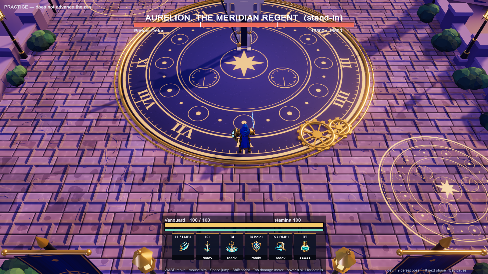
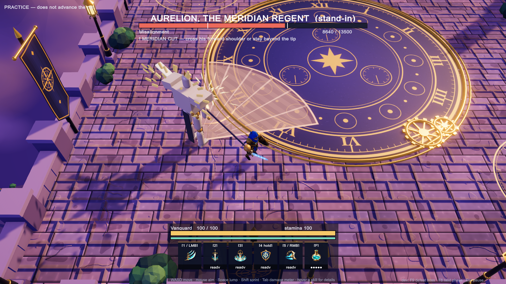
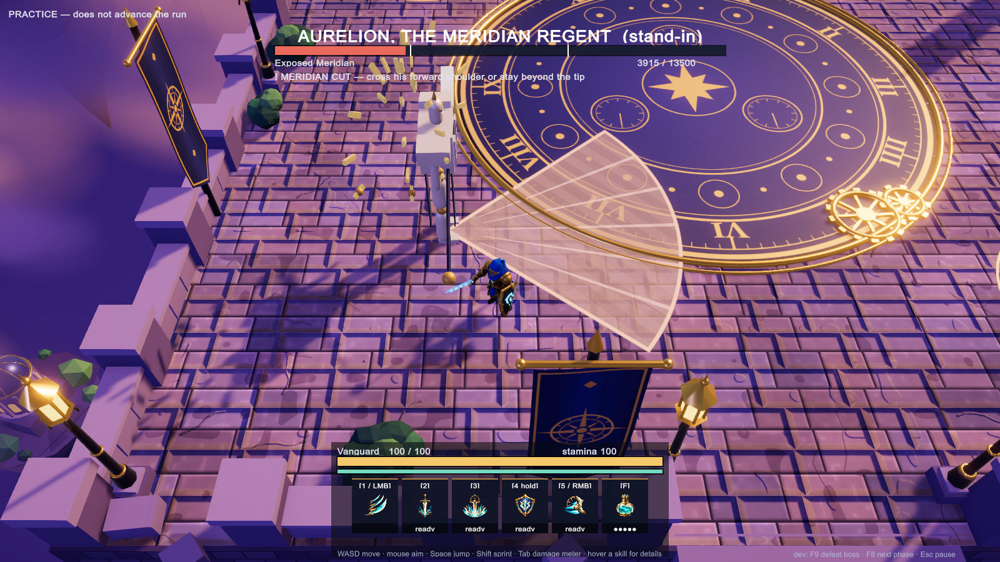

# Aurelion, the Meridian Regent: grey-box encounter

The Skyward Spire area boss, built from Codex's four-boss handoff ([PR #46](https://github.com/Risxhb/collab/pull/46), board [#47](https://github.com/Risxhb/collab/issues/47)). The branch is `feature/boss-aurelion`, stacked on `feature/run-loop` ([PR #42](https://github.com/Risxhb/collab/pull/42)).

Aurelion is a **practice-only slot** for now. Open the menu and pick **Practice one encounter → Aurelion**. The run itself is unchanged. The model is a code-built stand-in (`Placeholder`). The fight takes place in the shared test arena, not the Skyward Spire scene.

## What's implemented

The code is in `unity/Assets/LastBell/Run/Encounters/AurelionEncounter.cs`. All numbers come from the packet. Times are at 60 Hz.

| Attack | Shape | Warning / tracking stops | Recovery | Cooldown | Damage |
|---|---|---|---|---|---|
| Meridian Cut | 80° cone, 6 m | 1.6 s / after 0.3 s | 1.5 s | 5 s | 14 |
| Zenith Pins | 1.3 m circle on 1 / 2 / 3 players (1, 2–4, 5–8) | 1.8 s / after 0.5 s | 1.4 s | 9 s | 12 |
| Processional Thrust | 2 m lane, up to 9 m, fixed when the warning appears | 1.7 s | 2.2 s | 11 s | 16 |
| Crown Reversal | rear 120° sector, 4 m | 1.5 s | 1.8 s | 8 s | 12 |
| Meridian Alignment | ring 4–8 m, then ring 1.7–4 m | 2.0 s + 1.8 s | 3.0 s (chest open) | 20 s | 14 per ring |

The fight has three phases:

- **Perfect Order (100–65 %).** One attack at a time, with an extra 0.5 s pause after each. Standing at range invites the Thrust.
- **Misalignment (65–30 %).** Pins lead into Cut. The Cut's warning starts when the pins lock, so the pins resolve first, at 1.8 s against 2.1 s. Crown Reversal turns on once a player has stood in his rear sector for **more than 3 s**.
- **Exposed Meridian (30–0 %).** Alignment, then the full 3 s open-chest recovery, then a Thrust.

Rules from the packet that the code follows:

- **Phase changes.** A phase change waits until the current attack ends. It plays a 1.5 s transformation that deals no damage and shows no warning. Damage that skips past both thresholds plays a single transition.
- **Overlap.** At most two damaging patterns are live at once. Pins + Cut is the only overlap.
- **Hit-stun.** Every hit stuns for 0.15 s.
- **Charge endpoint.** The Thrust endpoint is clamped to the boss bound, which leaves a 0.9 m corridor along the wall.
- **Pin withdrawal.** A pin whose recipient goes down is withdrawn before it locks. It uses the new `HazardSystem.Cancel`.
- **Defeat.** On defeat every warning is cleared. He plants the glaive, kneels, the pendulum stops, and the halo arcs fall inert.

**HP is 13 500.** This follows the packet's rule (measured sustained DPS × 150 s): the autotest measured Vanguard at about 90 DPS while moving and dodging.

## Changes to shared files (small hooks)

- **`RunDirector`:** `PracticeAurelion = 4` as a practice slot, plus `PracticeName()`. The F8 dev key now asks the boss for its next phase fraction through the new `BossEncounter.NextPhaseFraction()`. Bellkeeper behaviour is unchanged.
- **`RunHud`:** a fifth practice button, the hint text for each Aurelion warning, and 65 % / 30 % marks on the health bar.
- **`Hazards` and `BellkeeperFx`:** `HazardSystem.Cancel(h)` and `Telegraph.Cancel()`, which withdraw one hazard without resolving it.
- **`RunAutoTest`:** now a `partial` class. The Aurelion section is in `RunAutoTest.Aurelion.cs`. `-lastbellAurelionOnly` runs only that section.

## Evidence: the autotest's Aurelion section (41 checks)

**Route proofs** use the real `Hazard.Contains` geometry with the player margin, the boss body and the floor bound. They assume no dash and no jump, and allow 0.25 s of reaction. Each one checks that the worst-placed player can walk clear within the warning left after it locks. The 4.2 m/s rows are the prototype walk and the 6.0 m/s rows are the design walk.

| Attack | Worst walk | Spare at 4.2 m/s | Spare at 6.0 m/s |
|---|---|---|---|
| Meridian Cut | 2.60 m | 0.43 s | 0.62 s |
| Zenith Pins | 1.65 m | 0.66 s | 0.78 s |
| Processional Thrust | 1.35 m | 1.13 s | 1.23 s |
| Crown Reversal | 2.25 m | 0.71 s | 0.88 s |
| Alignment I | 2.35 m | 1.19 s | 1.36 s |
| Alignment II | 2.70 m | 0.91 s | 1.10 s |

Pins → Cut is simulated tick by tick. A single straight walking route clears both from all 54 start positions tested, at both speeds.

**The live fight** uses a bot that only walks, at 4.2 m/s, reacts 0.25 s after a warning locks and never dashes. It plays all three phases (one stretch in melee on his flank, one at range, one camping behind him) and **takes no damage**. The invariants checked are:

- phase queueing, and a single transition when damage skips both thresholds
- the Reversal only after more than 3 s behind him
- ring II only after ring I has resolved
- pins resolving before the cut
- at most two damaging patterns live at once
- nothing appears during phase transformations
- the short hit-stun
- death clears every pending warning

## Notes for the boss review

- **Alignment's inner safe zone.** The 0–1.7 m centre is not a real safe spot: his body (radius 1.1 m) plus the player's (0.45 m) fill it. The pattern works as the packet describes it: stand inside 4 m for ring I, then walk outward past 4 m for ring II.
- **The Thrust's timing.** As with the Bellkeeper's charge, the lane deals its damage when the warning ends and the boss then travels for 0.5 s. The packet describes damage during the travel. This is a framework-wide choice, not something specific to Aurelion.
- **Things the reference sheet suggests that the code deliberately doesn't do.** Phase 2 "broader, more erratic" attacks would mean bigger shapes, so the attack shapes stay fixed. The bright Phase 3 floor rings are drawn only as the warning shapes.

## Not done yet

- **Stagger.** There is no boss stagger yet, so interrupt-lock protection isn't needed.
- **Counterclock.** This is the extra Midnight Toll attack, and the run has no difficulty tiers yet.
- **Model and media.** No authored model, animation or audio. The Skyward Spire arena (from `feature/class-test-arena`) is not used.
- **Two or more players.** Pins assign 1, 2 or 3 circles by party size, but the run only spawns one player.

## Screenshots (autotest run 7, 147/147 passed)

   
