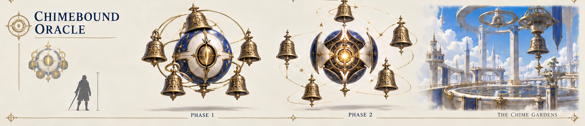

# The Chimebound Oracle — encounter specification

Draft v0.1 · October 21, 2026 · Mini-boss 1-3, Skyward Spire · Auditor of Five Notes

Status: **specification only.** It targets the Unity/C# run loop ([PR #42](https://github.com/Risxhb/collab/pull/42)). There, `ChimeboundOracle` in `unity/Assets/LastBell/Run/Encounters/Minibosses.cs` is a labelled stand-in: Shattered Chime and Dividing Chime, no phases. Section 9 lists what this spec adds to it.

**Sources and the rule for conflicts.** This spec takes the boss's identity, phases and new attacks from Codex's mini-boss packet (branch `docs/nine-mini-bosses-20261021`, commit `a2ab311`, Chimebound Oracle section). It uses the rules the project already agreed for the Bellkeeper ([spec v0.3](https://github.com/Risxhb/collab/blob/docs/bellkeeper-spec/docs/design/bellkeeper.md), PR #16): **keep the current numbers, and adopt the packet for identity, names and new mechanics.** Where the packet and the agreed rules disagree, §2.1 lists both and says which one is used. New numbers appear only where nothing existed before, and the escape check (§5) backs each of them.

Companion files:
- [escape checker](../../tools/encounter-escape/oracle-escape-check.ps1) and its [results](../../tools/encounter-escape/oracle-results-2026-10-21.md)
- [concept art, both phases](media/chimebound-oracle-concept.png)

## 1. Identity

A floating sphere that audits the Spire's harmonic schedule with **exactly five orbiting bells**. It sits third in the slice gauntlet: Dial Warden → Pendulum Sentinel → **Chimebound Oracle** → intermission → The Bellkeeper. It teaches the Bellkeeper's Shattered Chime and the "markers, then a cone" rhythm of Block B (Bellkeeper spec §9).

- **Model.** Cobalt-and-ivory sphere about 2.2 m across, with a forward ivory eye-mask and a gold slit core. Five brass bells carry raised I–V glyphs and orbit in a compact halo. It has no legs and no humanoid parts.
- **Height.** The bottom of the sphere always hangs within normal melee reach. It is never immune because it flies, and every class can hit it from the ground.
- **Phase 2 look.** The sphere opens like an iris to expose the core. The same five bells spread to stepped heights, one per numeral. The silhouette and function change, not only the glow.
- **Colour rules.** Gold core brightest at rest. Hostile effects use coral/amber outlines, hatching and countdowns. Turquoise is never danger. The player Chimesinger's bells and Harmony effects never use coral, so the two kinds of bell stay distinct.
- **Station.** It appears before the **Five-Note Belfry** on the north side of the shared Spire floor. The concept sheet's vignette caption "The Chime Gardens" is a mood label only. It should be renamed, because "Chime" + "Gardens" reads as Verdant Chimes (D-O3).
- **Collision.** 1.2 m radius (the stand-in's `BodyRadius`). Player centres stay at least 1.5 m from the boss centre.
- **Reward proposal.** Fifth Note bell charm and a five-note victory sound, cosmetic only (deferred with all rewards).

## 2. Baseline values

Units are metres and seconds, and the simulation runs at 60 Hz. Shared values are the Bellkeeper spec's §2.

| Value | Used here |
|---|---|
| Walk / dodge | 6 m/s; 3 m dodge over 0.20 s, no invincibility. The older 4.2 m/s test walk is still reported by the checker |
| Arena | Key-art arena: player centres ≤ 11.5 m from the centre |
| Boss position | **Within 3 m of the arena centre** (the packet's leash), always. The stand-in drifts out to 8.5 m; §5 shows why the leash matters |
| Player hit margin | 0.3 m: shapes are expanded by it, and touching a border counts |
| Hit reaction | 15 ticks (0.25 s) stun + 1.5 m knockback, the run-loop default |
| Phase shift | 90 ticks (1.5 s), non-damaging, boss stays targetable |
| Boss HP | 1700 at one player (stand-in value); party scaling `× (1 + 0.6 × (n − 1))`, HP only (Bellkeeper D6) |
| Tier used by the slice | Steady Ticking. Other tiers in §5 |

### 2.1 Packet vs the values used here

| Item | Packet | **Used here** | Why |
|---|---|---|---|
| Shattered Chime | 1.5 m circles; 1.9 s warning, "lock 1.1 s early" (ambiguous) | **1.4 m** circles; follow 30 + **48 after lock** (0.5 + 0.8 s); 24 ticks apart; 12 damage | Current stand-in and Bellkeeper numbers. This also settles the ambiguity: the final lock is 0.8 s, which the check passes walk-only |
| Dividing Chime | 70° cone to 7 m; 1.6 s warning | 70° cone (35° half) to **6.5 m**; 18 tracking + **51 after lock**; 20 damage | Current stand-in numbers (same timing as the Bell Sweep) |
| Dividing Chime solvability | No pattern may need stamina | **One dodge allowed at Steady Ticking and harder**, walk-only at First Chime | The Bellkeeper's agreed tier rule (spec §5.1). Only Dividing Chime uses the dodge (§5) |
| Sequencing | One damaging pattern at a time | At most **two** at once (a marker volley counts as one), and only in Phase 1's combined loop | Bellkeeper rule. The stand-in already overlaps markers and cone, and that overlap is what the Oracle teaches for the Bellkeeper. Its timing is moved to meet the anti-chain rule (§4.1) |
| Hit-stun | ≤ 0.15 s, no knockback | 0.25 s + 1.5 m knockback | Current build values |
| Phase transition | 2 s | 90 ticks (1.5 s) | Current build value |
| Marker count by party | 1 / 2 / 3 players, at most 3 markers | Bellkeeper §6 table (§6) | Agreed Bellkeeper scaling |
| Unison Needle length | 10 m | **To the arena edge** | 10 m let ranged players stand out of reach (packet's own exploit note). The leash puts every player within 14.5 m |
| Damage scale | L 10 / M 18 / H 26 | Shattered 12, Dividing 20 (current); new heavy attacks **26** | The packet's H value; below the Bellkeeper's heaviest (30) as befits a mini-boss |
| Silent Fifth "reject the cast unless every route fits" | Runtime rejection | **Not needed** | The check passes every orientation from every position inside the leash (§5) |
| Movement fairness numbers | 4.2 and 6 m/s, 0.30 s reaction | Design 6 m/s with per-tier reactions; 4.2 m/s reported | Bellkeeper method |

## 3. Attacks

All shapes come from the shared hazard set (`Circle`, `Cone`, `Lane`). Silent Fifth and Passing Silence are **one 288° cone** each (four 72° sectors in a single hazard), so a player on a sector border is hit once, not twice. No attack can be avoided by jumping.

| ID | Attack | Phase | Shape | Tracking and lock | Window at Steady Ticking | Damage | Kind | Recovery |
|---|---|---|---|---|---|---|---|---|
| `oracle_shattered_chime` | **Shattered Chime** | 1 | Circle r 1.4 m on a marked player | Follows its owner at 6 m/s for 30 ticks, then locks | 48 after lock | 12 | Ground | 60 |
| `oracle_dividing_chime` | **Dividing Chime** | 1, 2 (unchanged) | Cone 6.5 m, 70° | Boss turns toward the target for 18 ticks, then locks | 51 after lock | 20 | Strike | 60 |
| `oracle_silent_fifth` | **Silent Fifth** | 1 | Cone 6.5 m, 288°, gap = sector V | Fixed at warning | 144 from warning | 26 | Ground | 204 (3.4 s) |
| `oracle_afterchime` | **Afterchime** | 2 (replaces Shattered) | Shattered Chime, then a repeat of all its locked circles | Repeat fixed at the original positions | Originals as Shattered; repeat 90 from warning | 12 each; repeat 12 | Ground | 192 (3.2 s) after the repeat |
| `oracle_passing_silence` | **Passing Silence** | 2 (replaces Silent Fifth) | Beat 1 = Silent Fifth; beat 2 = same cone rotated one sector | Each beat fixed at its warning | 144, then 120 | 26 per beat | Ground | 228 (3.8 s) |
| `oracle_unison_needle` | **Unison Needle** (new) | 2 | Lane 1.5 m wide from the boss centre to the arena edge | Follows boss → target for 48 ticks, then locks | 60 after lock | 26 | Strike | 180 (3.0 s) |

### 3.1 Shattered Chime
The stand-in, unchanged. **Tell:** bell I glows coral and a short three-note cue plays. Each marker is a coral hatched circle with a countdown ring, and a shape tag sits over the marked player. Markers spawn 24 ticks apart. Lesson: drag the marker somewhere harmless, then step out.

### 3.2 Dividing Chime
The stand-in, unchanged, and kept as Phase 2's retained attack. **Tell:** one bell swings ahead of the sphere with a rising note, and a bright wedge shows on the floor. During the 18 tracking ticks the wedge's edge is drawn dashed. At lock it latches solid and stays fixed. The response is to walk to a flank. Running straight away inside the cone is the losing route, and the tutorial prompt says so.

### 3.3 Silent Fifth
**Tell:** the boss stops and faces bell V. Bells I–IV rise and glow coral, and bell V drops low with a hollow-circle glyph. The floor around the boss shows five 72° sectors out to 6.5 m. Each sector carries a large painted numeral (I–V, about 1.2 m tall) at mid-radius, so the order is readable from the game camera and in grayscale. Sectors I–IV are coral hatched. Sector V is unfilled, with only its numeral and the hollow circle.

**Resolve:** all four hazardous sectors pulse once, as a single hit. Safety is **sector V, or anywhere beyond 6.5 m**. Melee players read V and stay near the body. Ranged players can step outside the ring.

**Orientation:** sector V is chosen by the seeded encounter RNG at warning. Every orientation is valid from every boss position inside the leash (§5), so no runtime rejection is needed.

### 3.4 Afterchime (Phase 2)
1. A normal Shattered Chime volley (§3.1), with the same markers, counts and timing.
2. As each original circle resolves, it leaves a **hollow dashed outline** at its locked position. The outline deals no damage and is visibly not a warning (no hatching, no countdown).
3. Twelve ticks after the **last** original resolves, every outline fills with hatching and a fresh countdown at once, with a lower echo note. This is a **90-tick** warning.
4. All repeats resolve **on the same tick as one attack event**. A player in several overlapping repeat circles takes one hit. This follows the packet's "merge intersecting markers" rule and the one-hit-per-instance rule (R16).
5. Recovery: 192 ticks.

Lesson: don't return to your old marks. This previews the Bellkeeper's Unfinished Hour, which also replays fixed world footprints.

**Contract need:** the repeat is a group of circles that resolves as one hit. That is a hazard group, as Sylvara's request R23 proposes. Until it exists, the Unity version can give the three repeat instances one shared `Hit` set.

### 3.5 Passing Silence (Phase 2)
- **Beat 1:** exactly Silent Fifth (144 ticks, 26 damage).
- **Beat 2:** on beat 1's resolve tick the old pulse disappears. One neighbour of V becomes the new safe sector, either clockwise or anticlockwise, chosen by the seeded RNG. It gets a fresh **120-tick** warning, and every other sector is hazardous, including the old V.

**Direction tell (no audio needed):**
- The new safe bell drops low and gains the hollow-circle glyph.
- The old V bell rises and turns coral.
- The new safe sector's floor numeral flips to the hollow style.
- A brass arrow sweeps along the floor from the old safe sector to the new one.

The response is to cross the one shared boundary near the body, or to stay outside 6.5 m. Recovery: 228 ticks (3.8 s), the encounter's major opening.

### 3.6 Unison Needle (Phase 2, new)
**Tell:** all five bells swing to point at one target, with a converging overtone.

**Beam:** a coral lane 1.5 m wide runs from the boss centre to the arena edge. It follows the boss → target line for 48 ticks with a dashed edge. Then it latches solid and stays fixed for **60 ticks** before it fires.

**Targeting:** targets rotate round-robin through standing players from a seeded offset, never the same player twice in a row when someone else is eligible.

**Lesson:** sidestep, and keep casting. Reaching the arena edge closes the "park beyond 10 m" exploit.

## 4. Phases and timeline

| Phase | Name | Boss HP | Content |
|---|---|---|---|
| 1 | **Ordered Choir** | 100–50 % | Stationary casting posture; drifts only between attacks, within the leash; faces the next sounding bell |
| 2 | **Broken Order** | 50–0 % | Iris open, bells at stepped heights. Afterchime replaces Shattered Chime, Passing Silence replaces Silent Fifth, Dividing Chime stays, Unison Needle is new |

**Transition.** Crossing 50 % queues the transition until the active attack finishes, including both beats of a multi-beat attack. Then all hazards expire, the iris opens over 90 non-damaging ticks, and Phase 2 starts its loop from the top.
- The boss stays targetable, gains no heal and keeps one health bar.
- Player seals, bells and timers keep running.
- A burst that crosses the threshold queues one transition only.
- A lethal burst ends the fight immediately and cancels every pending hazard.

There is no enrage and no third phase.

### 4.1 Phase 1 — Ordered Choir (loops)

Ticks are from the start of the volley. During the volley the boss drifts away from the target at 1.2 m/s while the target is within 3.5 m, never leaving the 3 m leash (the stand-in's behaviour, re-bounded).

**First loop (teaching).**
1. Shattered Chime: markers spawn at 0, 24 and 48, and resolve at 78, 102 and 126.
2. A 60-tick gap.
3. Dividing Chime on its own (69 ticks), then 60 ticks of recovery.

**Later loops (combined).** The same markers, but the Dividing Chime starts warning at tick **110**, so it locks at 128 and resolves at **179**.
- The stand-in starts the cone at tick 78. Its cone then resolves 21 ticks after the third marker, so a player hit by that marker (15-tick stun) would get 6 ticks to leave the cone. That breaks the Bellkeeper's anti-chain rule (§5.4).
- At 110 the gap is 53 ticks. That covers the 15-tick stun plus the 38-tick Steady Ticking cone escape.
- The cone's own timing is unchanged.

**Then in every loop.**
4. Drift back to the centre (≤ 90 ticks at 2 m/s).
5. **Silent Fifth** (144 ticks), then 204 ticks of recovery, the major punish window.
6. Repeat.

One loop is about 11 s.

### 4.2 Phase 2 — Broken Order (loops)

Afterchime (originals plus repeat, 228 ticks; recovery 192) → Dividing Chime on its own (69; recovery 60) → Unison Needle (108; recovery 180) → drift to the centre → Passing Silence (144 + 120; recovery 228) → repeat.

Only one damaging pattern is active at a time in Phase 2. Circles never combine with the sector attack. Example: Afterchime → stay off the old footprints through the repeat → punish → Passing Silence → cross one boundary → punish for 3.8 s.

### 4.3 Seeded variation
Sector V's orientation, Passing Silence's direction and the Needle's starting target come from the seeded encounter RNG at warning time. They never read player inputs, and no warning is ever shortened.

## 5. Fairness: escape check

`tools/encounter-escape/oracle-escape-check.ps1` (about 8 s) uses the Bellkeeper checker's method with one improvement: **paths route around the boss body** (tangent + arc), instead of passing through it. That matters for the sectors, where the safe sector is often behind the sphere.
- **Samples:** every boss position inside the bound, orientations in 15° steps, and reachable danger points on a 0.1–0.2 m grid.
- **Passing Silence beat 2** is checked twice: from the places beat 1 left safe (the realistic case), and from anywhere (a player who was hit).
- **Full output:** [oracle-results-2026-10-21.md](../../tools/encounter-escape/oracle-results-2026-10-21.md).

**Results, boss inside the 3 m leash:**

| Attack | d_max (m) | First Chime (walk) | Steady Ticking | Steady walk-only | Striking Hour | Midnight Toll | 4.2 m/s walk | **Used (Steady)** |
|---|---|---|---|---|---|---|---|---|
| Shattered Chime, after lock | 1.71 | 54 | 34 | 45 | 28 | 25 | 61 | **48**, walk ok |
| Afterchime repeat, from warning | 1.71 | 54 | 34 | 45 | 28 | 25 | 61 | **90**, walk ok |
| Dividing Chime, after lock | 2.67 | 63 | 38 | 54 | 32 | 29 | 75 | **51**, needs one dodge |
| Silent Fifth, from warning | 4.50 | 81 | 54 | 72 | 48 | 45 | 101 | **144**, walk ok |
| Passing Silence beat 2, from safety | 3.41 | 71 | 44 | 62 | 38 | 35 | 85 | **120**, walk ok |
| Passing Silence beat 2, from anywhere | 4.53 | 82 | 55 | 73 | 49 | 46 | 101 | **120**, walk ok |
| Unison Needle, after lock | 1.10 | 47 | 32 | 38 | 26 | 23 | 52 | **60**, walk ok |

**Findings**

1. **The leash matters.** With the stand-in's drift (boss up to 8.5 m out), the Dividing Chime's worst escape grows from 2.67 to **3.48 m** with the boss facing the wall. It then needs 62 ticks walk-only against the 51 used. The 3 m leash keeps the cone inside the agreed one-dodge rule with margin (38 ≤ 51).
2. **Dividing Chime is the only attack that needs a dodge at Steady Ticking**, and only in the worst spots. That is allowed by the agreed rule, and it's the same as the Bellkeeper's Bell Sweep. If mini-bosses should be walk-only (the packet's wish), the window becomes 54 after lock (D-O1).
3. **The sector attacks have large reading margins.** Silent Fifth needs 54–72 ticks against 144, and Passing Silence 55–73 against 120. The extra time is deliberate: it pays for reading which bell is silent. Higher tiers may shorten it toward the minimums below. Every sector orientation is walkable from every position, so the packet's runtime rejection isn't needed.
4. **The Shattered Chime's 0.8 s final lock** passes walk-only at 6 m/s (45 ≤ 48). At the old 4.2 m/s walk it would need 61 ticks at First Chime, the same result as the Bellkeeper's identical marker.

**Proposed windows per tier** (ticks; Steady Ticking is used by the slice):

| Attack | First Chime | Steady Ticking | Striking Hour | Midnight Toll |
|---|---|---|---|---|
| Shattered Chime, follow + after lock | 30 + 57 | 30 + 48 | 30 + 36 | 30 + 30 |
| Afterchime repeat, from warning | 100 | 90 | 90 | 90 |
| Dividing Chime, tracking + after lock | 18 + 66 | 18 + 51 | 18 + 45 | 18 + 39 |
| Silent Fifth, from warning | 156 | 144 | 120 | 102 |
| Passing Silence beat 2, from warning | 132 | 120 | 102 | 90 |
| Unison Needle, tracking + after lock | 48 + 66 | 48 + 60 | 48 + 54 | 48 + 48 |

**Limits.** No other players, no acceleration, grid sampling to about ±0.1 m. These checks cover single attacks and Passing Silence's two beats, not proof of every combination. The Phase 1 combined loop is cleared by the anti-chain spacing in §4.1, not by a union check.

**Stamina.** Only the Dividing Chime may need a dodge, at most once per loop (about every 11 s), well inside the "one dodge per 2.25 s" budget. Sprint and jump are never required.

## 6. Party size (1–8)

Geometry and timings are identical at every count; only HP and marker counts scale.

| Count | Shattered Chime / Afterchime originals | Dividing Chime | Silent Fifth / Passing Silence | Unison Needle |
|---|---|---|---|---|
| 1 | 3 sequential markers on the player | 1 cone at the player | World-fixed, same for all | 1 beam at the player |
| 2–4 | Every standing player gets 2 sequential markers | 1 cone at one seeded target, marked before lock | Same | 1 beam; targets rotate |
| 5–8 | `ceil(n/2)` marked players × 2, alternating subgroups between volleys | 1 cone | Same | 1 beam; targets rotate |

- The marker rows are the Bellkeeper §6 table. The Afterchime repeat replays every locked original as one merged hit, so at 8 players up to 8 circles repeat together.
- Silent Fifth's safe sector V holds 8 players easily: about 20 m² of player-centre space inside 6.5 m, not counting the outside ring.
- No assignment depends on class, and no mechanic needs a healer, a Brace, a dodge or simultaneous switches.

**Down, revive and disconnect** (Bellkeeper §7):
- A marker owner or Needle target lost **before lock** cancels or retargets. After lock, geometry stays where it is and can hit revivers.
- Downed and disconnected players are never targeted.

## 7. Melee / ranged balance

| | Melee | Ranged |
|---|---|---|
| Advantage | Short hops between sectors next to the body; markers dropped beside the boss and walked off around it | Outside-the-ring refuge during sector attacks; stationary casting through the long recoveries |
| Challenge | Must read the silent bell, not just run | Markers follow them; the Needle reaches the whole floor |
| Exploit and prevention | — | Parking far away: the Needle reaches the arena edge and markers follow everywhere |

The fixed, reachable body and the three long recoveries (Silent Fifth 3.4 s, Afterchime 3.2 s, Passing Silence 3.8 s) are the Vanguard heavy-attack and caster-commitment windows the packet asks for.

**Tuning priority:**
1. The five-bell count must read clearly from the game camera.
2. Sector reachability, already checked here.
3. Boss HP from measured group DPS, aiming at the packet's 90–150 s fight.

## 8. Open decisions

| ID | Question | Recommendation |
|---|---|---|
| D-O1 | Should mini-bosses be walk-only at Steady Ticking (packet), or follow the Bellkeeper's one-dodge rule? Only Dividing Chime is affected | Keep the agreed rule (51 after lock); if walk-only is wanted, use 54 |
| D-O2 | The packet assumes Vanguard's partial Brace exists; the core rules say no block or parry. The build has Brace (`HazardKind.Strike`). This encounter tags its hazards Strike/Ground and never assumes Brace | Settle once for the whole project, not per boss |
| D-O3 | Vignette caption "The Chime Gardens" vs station "Five-Note Belfry" | Use Five-Note Belfry; rename the caption |
| D-O4 | Phase 2 damage 26 for the three heavy attacks | Keep until measured playtests |
| D-O5 | Hazard groups for the Afterchime repeat (with Sylvara's R23) | Shared `Hit` set as the interim Unity fix |

## 9. Changes for the Unity stand-in

**Status: implemented** on branch `feature/oracle-standin`, which is stacked on `feature/run-loop`. The code is in `Encounters/ChimeboundOracle.cs`.
- The focused acceptance test passes 26/26. To run it:
  `Unity.exe -projectPath unity -executeMethod LastBell.Run.EditorTools.OracleTestTools.PlayModeTest -oracleTest -lastbellOut <dir>`
- It has three stand-ins:
  - The seeded encounter RNG (R6) is a fixed-seed `System.Random`.
  - The hazard group is `Hazard.Group`, a shared hit set.
  - Marker party scaling stays the run loop's (nearest player).

The list below is what was needed:
1. **HP phases** at 50 %, with a queued 90-tick iris transition.
2. **Leash:** drift bound 3 m from the centre (now `BossBound − 1` = 8.5 m).
3. **Combined loop:** start the Dividing Chime at tick 110 instead of 78.
4. **Silent Fifth / Passing Silence:** one `Cone` hazard each, with `HalfAngle = 144` and `Yaw` pointing away from the safe sector. No new shape is needed, because `Hazard.Contains` handles a 288° cone. They also need the floor numerals and the bell drop/rise presentation.
5. **Afterchime:** outlines on resolve, then grouped repeat circles (one shared hit set).
6. **Unison Needle:** a `Lane` that follows the target for 48 ticks, with its length set by `ToEdge`.
7. **Model:** the five-bell sphere, with the Phase 2 iris and stepped bell heights. The concept art is the reference.
8. **Autotest cases:**
   - every sector orientation is walkable
   - nobody takes a double hit on a sector border
   - the Afterchime overlap gives one hit
   - the Needle reaches the far wall
   - the transition queues behind Passing Silence's second beat
