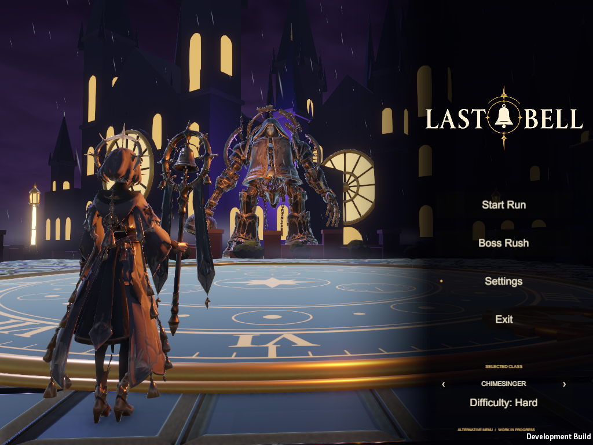

# Confrontation alternative menu — October 23, 2026

Separate scene: `Assets/LastBell/Menu/ConfrontationMainMenu.unity`.

Preview: **Last Bell > Alternative Menu > Open Confrontation Scene**, then Play; **Preview in Play Mode** also opens it. Workspace launcher: `E:/Collab/Open Last Bell Confrontation.cmd`. The standalone preview uses `E:/Collab/Play Last Bell Confrontation.cmd` after its dedicated Windows build. Default startup/build settings and the original menus are preserved.

Implementation: existing Bellkeeper's Dais scene copied without its viewer/encounter scripts; existing circular clockwork floor, bell towers, bridges, lanterns, banners and character glTF assets reused. Three character presenters play authored Idle clips, retain their own equipment/materials and face the distant boss. Presentation offsets, yaw and scale are configurable per class. Boss uses `Characters/Bellkeeper2` (the project's bell-headed Bellwarden), beneath a wrapper at exactly `(2,2,2)`; source model and gameplay scale are unchanged. No player controller, world, damage system or encounter owner is installed in the preview.

The shared saved class is `SavedHeroSelection.Current` (`LastBell.Menu.Hero` PlayerPrefs), also written by normal HeroSelection. Start Run calls existing `MenuLaunch.Normal`; Boss Rush opens existing Boss-Rush Test Rush setup with the same selected class, rather than adding a new mode. Difficulty uses existing RunDifficulty. Settings uses existing MenuSettings and MenuMusic APIs. MenuInput handles keyboard, mouse and standard controller navigation. Exit stops Editor Play Mode, quits Windows, or returns to the normal menu in WebGL.

Weather: bounded rain/mist geometry (420 rain strips + 26 mist quads, reduced to 180/12 on lowest quality), animated existing banners, restrained torch flicker. Existing pipeline and music owner are reused; no package changes. Wet paving material and reflection probe belong to this scene copy. Fixed perspective camera widens for 4:3; UI respects safe area. No depth of field or motion blur. Atmospheric sound recordings, new cloth simulation and waterfall assets are not supplied by this change; existing music and authored idle/cloth movement are retained.

Validation: in progress; final results/evidence will be recorded after rendered Unity checks. This document does not claim concept-art fidelity or human visual/audio acceptance.

## Rendered validation record

Unity 6000.6.6f1 / URP 17.6.0. Final scene framing was inspected in actual Play Mode captures for Vanguard, Chimesinger and Arcanist. Resolutions: 1600×900, 1280×720, 2560×1080 and 1024×768. Automated checks assert actual framebuffer size, left-foreground hero / middle-distance boss framing, visible navigation, one active hero, animated bones in every Idle clip, exact `(2,2,2)` boss wrapper with unit visual scale, no combat authority, keyboard/controller focus and Settings, audio continuity, saved class reload, Boss Rush setup, all three classes' Start Run / pause / normal-menu return, preview unload and the original menu's Settings.

Pre-logo final Editor flow: **93 passed / 1 failed**. Every functional check passed; the zero-error assertion failed on two existing `SkywardSpireArena.OnValidate` prefab-material errors while randomized runs loaded Skyward Spire. Source: `Assets/LastBell/Areas/Area1/SkywardSpireArena.cs:82,122`, outside this menu's changes. A preceding two-transition Editor pass was **86/86, zero errors**; that narrower result does not supersede the final broader run. Initial framing and incorrect unpaused-return test were corrected; earlier screenshots/logs remain under separately named evidence folders.

Final transparent logo: `Resources/Menu/ConfrontationLogo.png`, generated with built-in imagegen from the user's second cropped reference. [Prompt and provenance](confrontation-logo.md). It is loaded only by this alternative menu.

The first Windows preview build (before logo replacement) succeeded, **0 errors / 46 warnings**. Logo-build and exact-player results are recorded below after completion.

## Visual compromises and limits

The scene uses the project's existing stylized characters and low-poly architectural geometry; it does not reproduce the concept's photoreal materials, volumetric weather or simulated fabric. Existing tower groups, dial, banners, lanterns, model Idle clips and music are reused. Rain and drifting mist use bounded meshes; no new particle/cloth/audio packages are added. Reflections are restrained probe-based reflections, without a new planar-reflection renderer. No waterfall asset or ambient rain/wind/bell recording was available in the inspected production menu assets. Distant lightning flashes are omitted; storm clouds and torch flicker provide movement without flashes. No existing reduced-motion setting was found. A fixed camera avoids continuous camera movement.

Human visual/audio acceptance, physical-controller feel, WebGL build and live deployment are not claimed. No source/wiki/board publication is part of this task. Wiki Updates/Task-List/progress will remain local drafts under the established publication boundary.

## Final Windows preview with generated logo

**95 passed / 0 failed / zero runtime errors**, final rendered Windows player, Unity 6000.6.6f1, test process completed normally. Dedicated logo build: **Succeeded, 0 errors / 46 warnings**. Existing pipeline/shader and obsolete-API warnings remain. This package includes the alternate scene, unchanged normal menu, existing selection screen and all existing playable maps; it does not replace the default project startup scene.

Player: `E:/Collab/builds/confrontation-menu/LastBell.exe`. Keep the complete adjacent player folder. Workspace launcher: `E:/Collab/Play Last Bell Confrontation.cmd`.

[Exact Windows report](validation/confrontation-windows-20261023.txt), [Editor report and existing viewer error](validation/confrontation-editor-20261023.txt). Full local evidence, failed/superseded runs and build logs: `E:/Collab/build-evidence/confrontation-menu-20261023/`.

Actual running Windows captures, after the new logo was installed:

Completed: separate animated 3D menu, all existing class models/Idle clips and shared saved selection, exact doubled presentation wrapper, existing Start Run/Boss Rush/Settings/audio APIs, economical weather, dedicated transparent generated logo, Play Mode and Windows validation, preview launchers and captured evidence.

Next: human visual/listening playtest; richer production environment materials, atmospheric recordings and waterfall/cloth assets can be considered in the existing content lane.

Blocked: no alternate-menu playback blocker. Full Editor zero-error acceptance is limited by the existing Skyward Spire prefab `OnValidate` errors on randomized run entry. No source upload, wiki publication, PR or live-site deployment was requested or performed.
