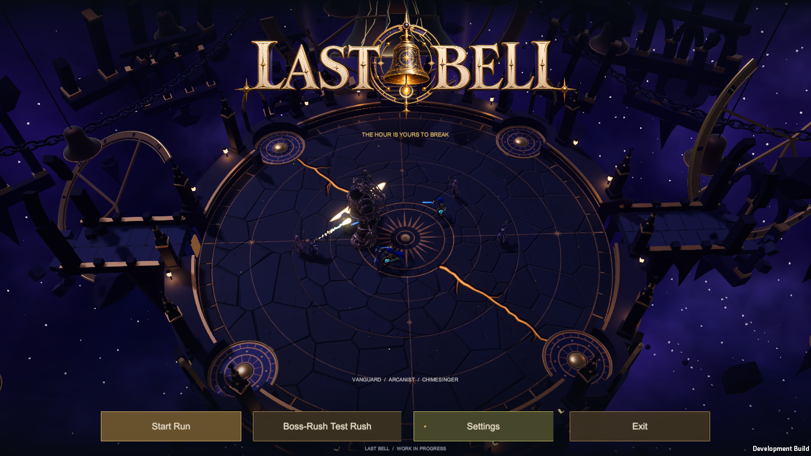
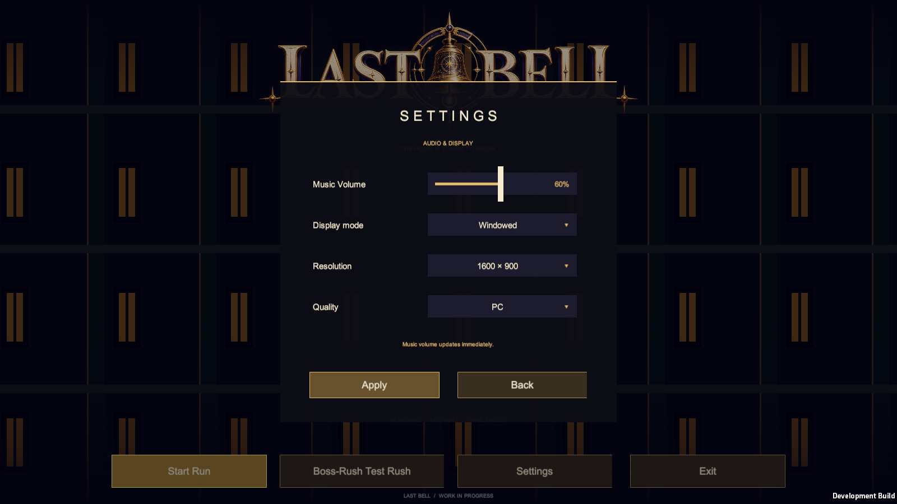

# Animated arena showcase

Open `Assets/LastBell/Menu/ShowcaseMainMenu.unity`, the first enabled build scene. It contains every showcase environment in one scene. The original `MainMenu.unity`, arena source scenes, hero selector and playable Run scenes are preserved.

| Order | Arena | Boss | Autonomous party |
| --- | --- | --- | --- |
| 1 | Test Map | Bellkeeper | 3 |
| 2 | Skyward Spire | Aurelion | 4 |
| 3 | Brass Foundry | Crucivar | 5 |
| 4 | Verdant Chimes | Sylvara | 6 |
| 5 | Shattered Hour | Bellkeeper | 8 |

The sequence loops every 75 seconds. The foreground clocktower facade enters at 14.2 seconds, conceals the first swap at 15 seconds, and exits by 15.8 seconds. Further swaps occur at 30, 45, 60 and 75 seconds. The menu renders above the facade, which never receives input. Settings remain interactive.

`Menu/MainMenuOpening.wav` is the exact supplied `mainmenu3.wav`. It plays first once per application session, then `MainMenuMusic` resumes its existing loop. The persistent music source continues across arena changes, hero selection and preparation; existing boss-track crossfades remain intact.

Menu actors reuse the existing models, animation presenters and presentation FX. They perform sustained autonomous choreography without creating a CombatWorld, damage authority or network session. Casts cannot die or finish the showcase. Eight player models and four bosses are cached during startup; each change switches the active cast and resets pooled FX and trails without instantiating models or graphs. Navigation stops the showcase, and scene unload releases the complete cache, including inactive actors. The rotation clock begins after scene preparation.

## Building and checking

- Windows: `LastBell.Menu.EditorTools.MenuShowcaseBuild.BuildWindows`; default output is `E:/Collab/builds/menu-showcase-current/LastBell.exe`, overridable with `LASTBELL_SHOWCASE_OUTPUT`.
- Browser: `LastBell.Menu.EditorTools.WebDemoBuild.Build`; output may be set with `LASTBELL_WEB_OUTPUT`. Includes showcase menu, hero selection and five playable maps. Build in a separate browser project to preserve the primary project's target.
- Rendered acceptance: launch a development player with `-lastbellShowcaseTest -lastbellOut <evidence-folder>`. Exercises two actual 75-second rotations, all casts, wipe coverage/input, continuous music, playlist advancement, bounded resources and selection/return cleanup. The opening clip is sought near its end to check playlist advancement.
- Existing navigation/hero/test-map/run regression: `-lastbellFlowStage 8 -lastbellOut <evidence-folder>`.
- Source arenas are never regenerated by these build commands. `Prepare Showcase Scene` only creates a missing derived scene and refuses to overwrite existing showcase work.

## Integration and validation

Integration starts at combined menu/run `2b7c342`. The current main README and browser build/template/input branch are merged locally; delivered boss-model branches are already ancestors. New ability-v2 and unrelated documentation/reference branches remain separate.

Rendered Unity 6000.6.6f1 Editor acceptance: **131 passed / 0 failed / zero runtime errors**, exit 0. Two complete actual rotations, all five environments/casts, Settings raycast/click during every wipe, source/track continuity, playlist advancement and selection/return cleanup passed. Material count stayed **415 → 415** across rotations, with bounded objects. Captures of every stage and the covered Settings screen were inspected. The opening song copy SHA-256 is `99a7765a3a63427432ffeddc527409c874c0b7f5df69e0413c4d3b30a105117c`.

The initial rejected runtime run exposed a dash-trail material leak and copied Skyward editor-viewer OnValidate error. Trail materials are now released with their actors; the derived showcase's environment instances are unpacked and its copied Skyward camera viewer removed, preserving all source assets. The first cold-start activity observation was moved later in the initial stage, with actual choreography time/travel recorded. Rejected logs are retained separately.

An earlier Windows package passed the full existing flow suite **563/563**, zero runtime errors. Its showcase run exposed hidden-window framebuffer capture failures and a streaming clip load-state condition preventing playlist advancement. The playlist now advances after observed playback stops, independent of streaming load-state flags. A normal-window rerun confirmed playlist/cleanup with zero errors and bounded materials, but caught a late swap/activity observation while a concurrent Web build was busy. Casts are now prepared once, and current builds/tests must validate this final cached-cast revision. Rejected and superseded evidence remains separate.

## Final cached-cast delivery — October 23, 2026

Implementation head: local `e2b5126`. Windows and WebGL builds on Unity 6000.6.6f1 each **succeeded with 0 errors / 40 warnings**, process exit 0. Warnings include existing URP/shader and obsolete-API warnings; they are not zero-warning builds.

- Exact current Windows showcase: **131 passed / 0 failed / zero runtime errors**, exit 0. Two complete timed rotations, every covered swap, 3/4/5/6/8-player casts, movement/skills, UI raycasts/clicks during wipes, persistent music, playlist advancement, selection/unload/return all passed. Materials **392 → 392**, bounded objects. [Report](validation/showcase-20261023.txt).
- Exact current Windows full flow: **563 passed / 0 failed / zero runtime errors**, exit 0. Includes all 20 map/encounter pairs, all heroes/difficulties, keyboard/mouse, framing, shuffled four-boss progression, retry/return and selected music. Boss progression uses the existing diagnostic defeat hook; it is not a natural full-run victory. [Report](validation/flow-20261023.txt).
- Current Windows package: 329 files, 1,377,717,472 bytes; local launcher `E:/Collab/Play Last Bell Showcase.cmd` and player `E:/Collab/builds/menu-showcase-current/LastBell.exe`.
- Current Web package: 13 files / 375,336,200 bytes, six data parts with verified SHA-256/lengths; full gzip CRC checks pass, expanded Unity data 440,528,010 bytes. Every file is below 100 MiB.
- Actual local Chromium/WebGL: animated arena changes, facade wipe, usable Settings/Back, hero selection, Vanguard skill panel, randomized run Ready, Sylvara opening combat on Verdant Chimes, pause and menu return. No browser console errors recorded. Audible playback and natural full-fight victories were not independently assessed.
- Generated demo uploaded to the existing [Last Bell site](https://risxhb.github.io/lastbell/) at Pages commit `b4304e6`. All **360 tracked site files outside `lastbell/`** remained byte-identical. Public deployment verification is recorded in the workspace handoff after the Pages build completes.

Source integration is local; no remote source PR was merged. Automatic approval review rejected a source-branch push because the explicit publication request named the demo site. Wiki updates are prepared locally without claiming publication. Source scenes, unrelated rendering edits and excluded reference/local directories are preserved.

Historical results in neighboring reports do not validate this revision. Human listening, visual approval and multiplayer acceptance remain separate from automated checks.
