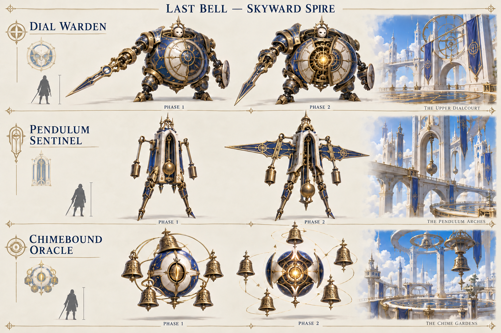
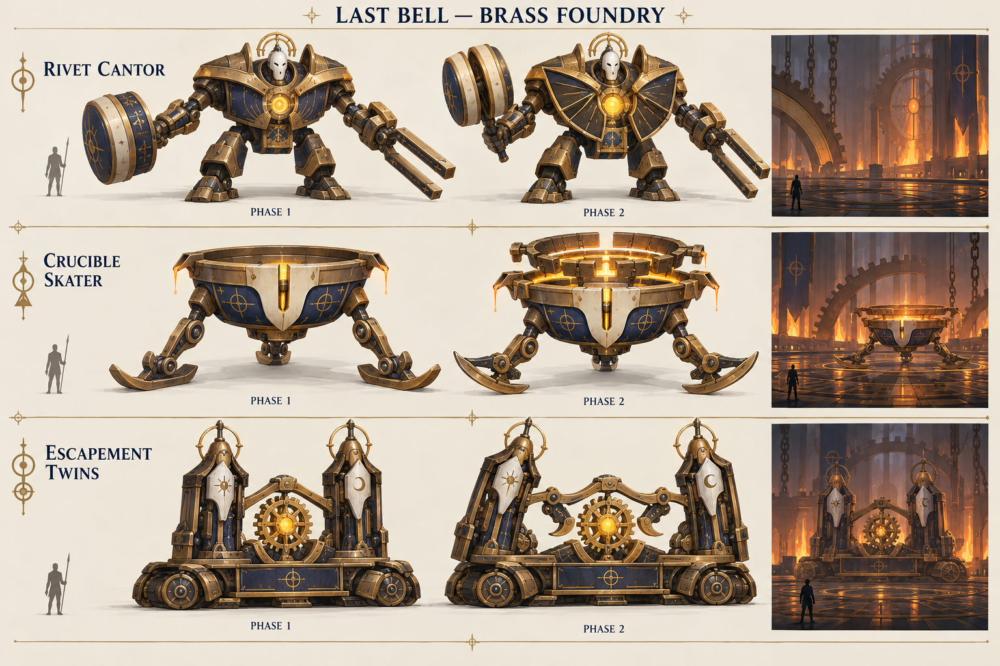
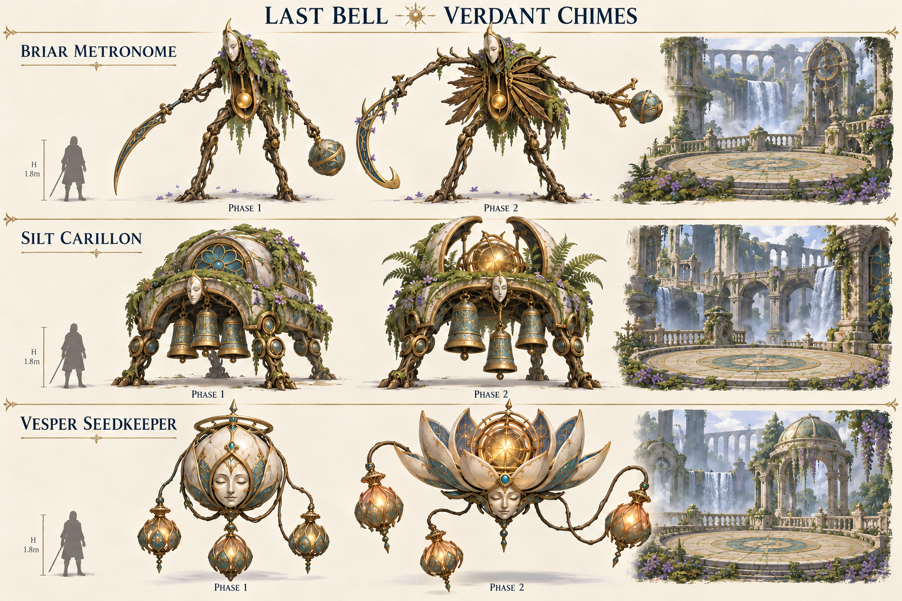

# Last Bell — Nine mini-bosses

October 21, 2026. Concept and encounter design proposal, not implemented gameplay or tested balance.

[Read the complete design](design.md) for all nine identities, arenas, two-phase ability kits, telegraphs, timings, damage estimates, melee/ranged counters, recovery windows, rewards and balance comparison.

Every boss has three Phase 1 abilities. At 50% health, two evolve, one remains and one new ability is added. No third phases. Hard difficulty is built around positioning and timing with finite stamina and no assumed dash invulnerability.

## Skyward Spire

- **Dial Warden:** offset clock-hand strokes and inner/outer dial safety.
- **Pendulum Sentinel:** committed charges, an announced return and swinging counterweights.
- **Chimebound Oracle:** five visible bells, numbered sectors and delayed echoes.

## Brass Foundry

- **Rivet Cantor:** short and held tuning-mallet beats.
- **Crucible Skater:** baited casting runs, temporary pours and cooling routes.
- **Escapement Twins:** one two-towered guardian; bait its strikes into its own pawls.

## Verdant Chimes

- **Briar Metronome:** inward/outward pruning cuts and changing safe spacing.
- **Silt Carillon:** sequential chime lanes that change order in Phase 2.
- **Vesper Seedkeeper:** planted seed circles that become hollow-center blooms.

## Production notes

The first trio expands existing early mini-boss concepts; the other six are proposed additions. These sheets are visual mockups, not rigged models. Human silhouettes communicate approximate scale; written dimensions require model-stage verification. Scene vignettes communicate mood rather than approved encounter layouts, and generated location captions are not canonical names. All fights use their area's shared dry, flat, unobstructed circular floor.

Images were created with the built-in image generation tool. [Original prompts](prompts.md) and [targeted corrections](art-corrections.md) are included. The written design governs mechanics and precise anatomy. Shops/progression remain deferred, so proposed rewards are optional trophies/cosmetics.
