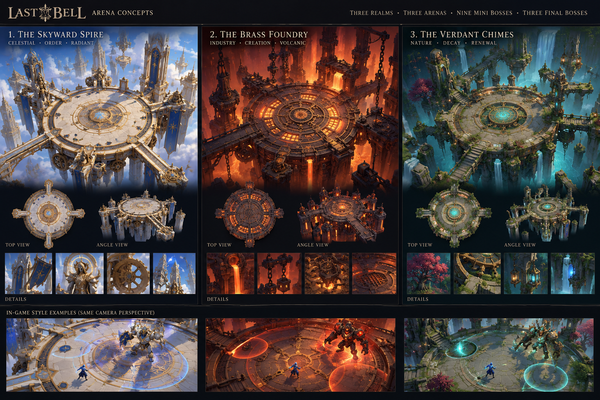
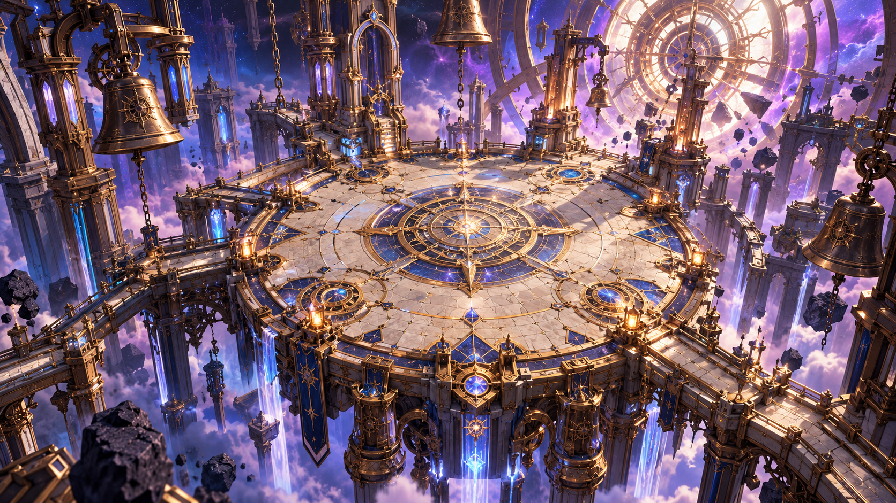
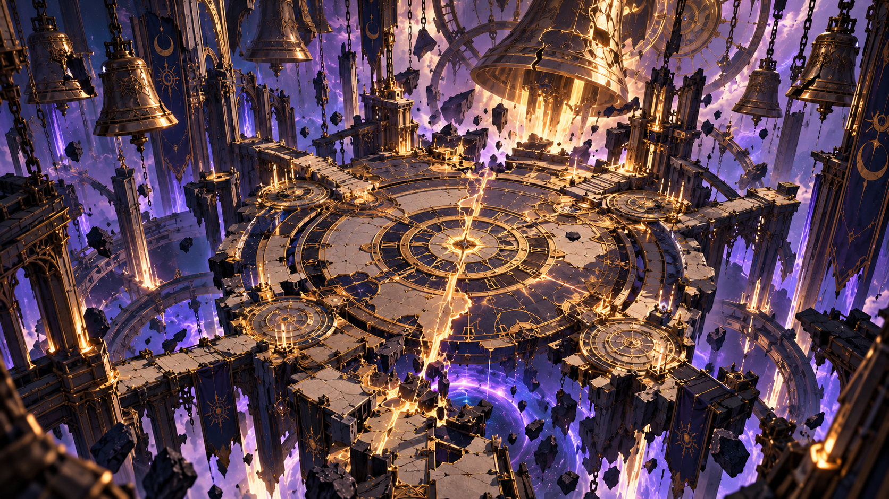

# Last Bell — The Shattered Hour

**Design status:** Proposed final area and boss arena concept  
**Game:** Last Bell — top-down action raid roguelite  
**Target art direction:** Gilded Twilight Clockwork Fantasy, painterly low-poly 3D, Unity URP, high-oblique gameplay camera  
**Concept date:** October 20, 2026

## Final area identity

# The Shattered Hour

> *“Where time itself was broken, and the final bell awaits.”*

**Arena name:** **The Throne of the Final Toll**

The Shattered Hour is the proposed fourth and final area of *Last Bell*. It is a ruined, impossible clockwork sanctuary at the end of time, visually distinct from the radiant Skyward Spire. The arena is surrounded by a cosmic abyss, fractured machinery, suspended bells, shattered architecture, and a colossal broken celestial bell.

## Campaign arena structure

The game has **four distinct arenas**. The first three areas each contain **three minibosses and one major boss**, all sharing their area's respective combat arena. After these twelve encounters, players enter **The Shattered Hour**, a separate fourth area dedicated to **one final boss encounter**. This produces **nine minibosses, three area bosses, and one final boss: thirteen encounters total**.

| Area | Visual concept | Encounters | Arena reuse |
|---|---|---|---|
| 1 — The Skyward Spire | Radiant celestial clockwork architecture, ivory, cobalt, gold, open skies | 3 minibosses + 1 area boss | Shared across all four fights |
| 2 — The Brass Foundry | Molten brass, massive mechanical furnaces, dark industrial fantasy | 3 minibosses + 1 area boss | Shared across all four fights |
| 3 — The Verdant Chimes | Overgrown clockwork ruins, turquoise resonance, verdant stone, waterfalls | 3 minibosses + 1 area boss | Shared across all four fights |
| 4 — The Shattered Hour | Broken cathedral machinery, enormous bells, fractured time, cosmic void | **1 final boss only** | Dedicated final arena: **The Throne of the Final Toll** |

**Scope lock:** The Shattered Hour does **not** replace The Verdant Chimes or any other original area. Its arena is unique and separate. Names and visual concepts for the first three areas are the established reference-sheet directions; their boss identities and mechanics are not specified here.

## The Throne of the Final Toll — arena concept

### Visual thesis

An extravagant circular battlefield suspended within a collapsing clockwork cathedral. Unlike the bright, orderly Skyward Spire, this is a place where the mechanisms of time have failed. A giant cracked bell looms over the battlefield, ancient chains and broken clock rings hang in the void, and warm gold energy splits the floor against dark cobalt stone and purple cosmic light.

### Primary landmarks

- **Central clock dial:** Broad, circular, dark stone combat floor with large, restrained gold clock markings.
- **Fracture of time:** A luminous golden fissure crossing the arena, treated as environmental art unless explicitly activated as a boss mechanic.
- **The broken bell:** A monumental cracked celestial bell behind and above the arena, serving as the final encounter's defining silhouette.
- **Suspended choir architecture:** Broken gothic arches, hanging bells, enormous chains, damaged columns, floating debris, and fractured clock rings beyond the playable edge.
- **The abyss:** A swirling violet-blue cosmic void below the platform, with isolated fragments of architecture and faint golden light shafts.
- **Peripheral ritual stations:** Four smaller dial-like structures around the arena rim, suitable as visual anchors for distinct encounter phases without implying gameplay functions until designed.

### Palette and material direction

| Element | Direction |
|---|---|
| Playable floor | Midnight cobalt and charcoal slate with quiet engraved brass arcs |
| Mechanical structures | Aged brass, blackened bronze, worn gold |
| Magical fractures | Radiant gold/ivory, used sparingly so hostile warnings remain dominant |
| Background | Twilight violet, deep indigo, cosmic lavender |
| Architectural accents | Porcelain ivory, dark blue banners, hanging chains |
| Lighting | Strong silhouette lighting, controlled gold focal highlights, cool atmospheric depth |

### Gameplay camera and production constraints

- Build the environment in **stylized low-poly 3D** with a **fixed high-oblique orthographic camera**, giving the 2.5D readability targeted for *Last Bell*.
- Keep the **playable floor broad, flat, and unobstructed** for four-player boss mechanics. Tall columns, chains, bells, and debris should remain outside playable bounds or fade when they occlude the action.
- Keep decorative clock markings less prominent than live cone, donut, stack, spread, tether, and other warning shapes.
- The gold fissure and peripheral circles should **not** look like active hazards unless the authoritative encounter logic says they are dangerous.
- This is a **dedicated final-boss arena**, not a reused arena for three minibosses. Its playable footprint and mechanics may be designed specifically for the finale.
- For any actual damaging or safe zones, derive visible telegraphs from gameplay geometry rather than from artist-painted floor decoration.

## Final boss presentation escalation (proposed)

The Shattered Hour hosts **one final boss fight**, potentially with several phases within that encounter:

1. **Arrival:** The fractured cathedral is largely dormant, with faint bell resonance and a slowly moving cosmic void.
2. **Opening phase:** Outer clock rings begin to turn, and the enormous broken bell establishes the encounter's visual rhythm.
3. **Escalation phase:** Gold fractures brighten and suspended architecture responds to the boss's attacks; visual effects remain subordinate to telegraphs.
4. **Final phase:** The Throne of the Final Toll fully awakens, with the great bell and broken clockwork forming the climactic backdrop.

These are **optional visual phase concepts**, not four separate bosses, locked mechanics, or implemented features.

## Complete artwork reference library

All three generated reference images from this arena-design discussion are included in the accompanying `artwork/` folder. The images are embedded below using standard relative Markdown paths, so previews work when this Markdown file and the folder are kept together.

### Reference 1 — Three original area references — Skyward Spire, Brass Foundry, Verdant Chimes

**File:** `artwork/a_wide_cinematic_concept_art_style_layout_poster.png`  
**Use:** Approved three-area reference board; includes top-down and gameplay-angle studies.

### Reference 2 — Final arena exploration — radiant celestial dais (superseded)

**File:** `artwork/a_cinematic_isometric_aerial_high_fantasy_sci_fi.png`  
**Use:** Early exploration rejected for looking too similar to the Skyward Spire; retained for design history, not final direction.

### Reference 3 — The Shattered Hour — selected final arena direction

**File:** `artwork/a_dramatic_high_detail_fantasy_sci_fi_scene_a_to.png`  
**Use:** Selected dark fractured cathedral, broken bell, cosmic void; visual reference, not final gameplay geometry.

**Production interpretation:** The selected Shattered Hour image is mood and composition reference; adapt it to painterly low-poly 3D, Unity URP, fixed high-oblique gameplay framing, and exact boss telegraph readability. The original three-area board remains the reference for Areas 1–3.

## Concept-to-Unity handoff

**Recommended first pass:** Block out a circular-looking but collision-accurate arena floor, its outer boundary, the four peripheral stations, and the silhouette of the enormous cracked bell. Then add the suspended clock rings, background architecture, and cosmic void. Validate a full-size combat camera screenshot before committing to high-detail assets.

**Suggested Unity scene name:** `ShatteredHour_FinalArena.unity`  
**Suggested environment prefab root:** `LB_ENV_ShatteredHour_Arena`  
**Suggested background landmark prefab:** `LB_ENV_FinalToll_BrokenBell`

**Open decisions:** exact arena dimensions and collision shape; identity and mechanics of the single final boss; whether the floor fracture or ritual stations ever become gameplay elements; phase transitions; and final performance budgets. None of these are locked by this concept.
